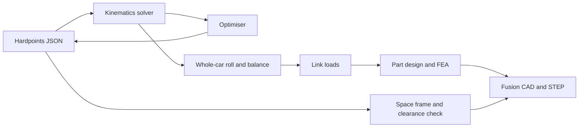

# Automated Suspension Design: Hardpoints to Full-Car CAD

**Ethan Diaz** · Personal engineering project · Python, Autodesk Fusion, Ansys Student

A Python and Fusion toolchain that turns one file of suspension pivot points into a
complete, checked design: kinematics, vehicle balance, member loads, part stresses, a
chassis that fits around it, and a full-car CAD model. A design revision that would
normally mean hours of re-sketching, spreadsheet work and remodelling runs in about
30 seconds. I used it to design the front and rear suspension of a Formula SAE style
car.

<p align="center"></p>

## The problem

A suspension's behaviour is set by where its pivot points (hardpoints) are. Move one a
few millimetres and the camber, steering, roll balance, member loads and chassis
mounts all change. In a typical workflow each of those lives in a different place: a
CAD sketch to measure geometry, a spreadsheet for loads, a separate FEA model, and a
chassis model with mounts placed by hand. So every revision means:

- re-measuring the geometry and re-running each spreadsheet by hand
- moving the frame's mounts and checking nothing now collides
- hoping every file was updated with the same numbers

That makes each loop slow and error-prone. Teams end up trying only a handful of
designs, and they find conflicts (a tube through a tie rod, a joint outside the rim)
late, in CAD or on the car.

## What this project does about it

**One source of truth.** All the geometry lives in one JSON file of hardpoints. Every
analysis and the CAD model are generated from it, so they can never disagree.

**The whole revision loop is automated.** Change a number and re-run:

| Step | What it produces | Time |
|---|---|---|
| Kinematics | Camber, toe, roll centre, caster, kingpin angle, scrub, motion ratio over ±50 mm of bump, plus plots | ~9 s |
| Steering, roll and packaging | Ackermann, roll camber and steer, joint clearance to the rim | ~6 s |
| Whole car | Roll stiffness, roll per g, front/rear load transfer split, tyre loads | ~6 s |
| Loads | Force in every link for 7 load cases, tube and rod end safety factors | ~6 s |
| Parts | Upright, rocker and bracket built around the hardpoints, with hand calcs | ~5 s |
| Chassis and assembly | Space frame fitted to the new pickups, clearance check, full-car CAD file | ~1 s |
| Fusion | The whole car built in CAD and exported as STEP | ~4 s |

These are measured times on an ordinary computer. The optimiser is a separate step
that takes about 2 minutes.

**The chassis follows the suspension.** The frame's front and rear suspension boxes
are generated from the hardpoints. Each wishbone pickup gets a frame node and a tab,
and the rocker, damper, anti-roll bar, steering rack and toe link mounts are placed
from their pivot points. Move a hardpoint and the frame moves with it. A clearance
check then tests every frame tube against every suspension part, so a clash is
reported straight away instead of being found in CAD.

**The optimiser explores designs for you.** Instead of trial and error, it moves
chosen hardpoints toward the targets you set (camber gain, roll centre, bump steer,
anti-squat and others) and treats the rim as a hard limit.

**The results are trustworthy.** 184 automated tests run on every change and check
the maths against things that must be true. For example, link lengths stay constant
to 1e-6 mm, and the energy into the tyre equals the energy into the damper.

### A real example

Partway through the design, a realistic ball joint housing turned out to hit the
wheel rim. I lowered the upper ball joint 6 mm and re-ran the chain. In under a
minute it gave the new camber gain (down about 10%), the new roll centre, the static
camber needed to stay on target (-1.75°), updated link loads, a re-checked upright
and updated CAD. By hand, that one change touches every model in the project.

## How it works



- **Kinematics.** The upright is a rigid body held by five fixed-length links (two
  per wishbone plus the tie rod). For each wheel height, a least-squares solver finds
  its position and rotation, and everything else (camber, roll centre and so on)
  follows from that. A second stage solves the pushrod, rocker and anti-roll bar.
- **Optimisation.** A weighted cost adds up how far each metric is from its target.
  SciPy minimises it over the free hardpoints, within bounds.
- **Whole car.** Both sides of each axle are solved as the body rolls. Roll stiffness
  from the springs and bars comes from the energy stored, and the two axles combine
  into roll per g and the load transfer split.
- **Loads.** For each load case the tyre forces are known. The upright's equilibrium
  (six equations, six links) gives the force in every link, and the rocker's
  equilibrium gives the damper and anti-roll bar loads.
- **Parts.** The uprights and rockers are built from simple solids around the
  hardpoints. They are checked by hand calcs and by an FE model (gmsh and
  scikit-fem), and the final design was confirmed in Ansys Student.
- **CAD.** The solver writes a JSON description of every body. Fusion scripts read it
  and build the car, so the CAD never needs remodelling by hand.

## Case study: a Formula SAE style car

I set a brief from typical FSAE numbers: a 280 kg car with driver, a 1550 mm
wheelbase, 10 inch wheels and a 1.5 g design corner. I then used the tool to design
both ends of the car.

| Target | Result |
|---|---|
| Outside tyre at -1° camber at 1.5 g | -1.02° front, -1.00° rear |
| Low roll centre that stays fixed on the chassis | 17 / 25 mm; moves 0.04 mm per mm of bump (from 0.38) |
| Near-zero bump steer | 0.002° or less over ±50 mm |
| 20 to 30% anti-dive and anti-squat | 23% / 25% |
| Positive Ackermann | +17% (from -16%) |
| 2.5 to 3 Hz ride frequency | 2.85 Hz front, 2.83 Hz rear |
| Mild understeer balance | 52% front load transfer vs 47% front weight; 0.84° roll per g |
| Safety factor 1.5 on tubes and rod ends | Lowest 3.8 (front lower wishbone rod end) |
| Safety factor 2 on machined parts | Front upright ~150 MPa in Ansys, SF 3.4 |
| Chassis fits the suspension | 126-tube frame, ~34 kg, no tube within 3 mm of a part |

Two findings I'd act on next: the front inside tyre lifts at about 1.9 g, and the
brake bias should move from 65% toward the ideal 77% front. The full reasoning is in
the [design report](docs/design-report.md).

## What I learned

- **Automating the loop changes the design.** When a revision costs 30 seconds instead
  of an afternoon, you try far more ideas and catch conflicts early.
- **An optimiser only knows what you tell it.** Left alone, mine found a "better"
  design that squeezed the ball joints together and would have doubled the arm loads.
  I had to add that limit as a goal.
- **FEA needs judgement.** A sharp inside corner gave a stress that kept rising as I
  refined the mesh (157 to 320 MPa), because a sharp corner has no true value. A real
  fillet brought it to about 150 MPa.
- **Strength isn't the only requirement.** The arms could be half the weight and still
  pass, but I kept the 3/4 in tube for stiffness and damage tolerance.

## Skills and tools

- **Vehicle dynamics:** suspension kinematics, roll centres, anti-dive and anti-squat,
  Ackermann, load transfer, ride and roll rates
- **Structures:** free-body load paths, tube yield and buckling, hand calcs, FEA with
  mesh convergence
- **Software:** Python (NumPy, SciPy, Matplotlib, gmsh, scikit-fem), pytest, GitHub
  Actions, git
- **CAD and CAE:** Autodesk Fusion API (scripted modelling, rendering, STEP export),
  Ansys Student

## Run it yourself

```bash
git clone https://github.com/EthanDiaz10/suspension-kinematics.git
cd suspension-kinematics
python -m venv .venv
# Windows: .venv\Scripts\activate    macOS/Linux: source .venv/bin/activate
pip install -e ".[dev]"

suspkin sweep data/optimized_front.json                              # kinematics and plots
suspkin car data/optimized_front.json data/optimized_rear.json       # whole car in roll
suspkin loads data/optimized_front.json data/optimized_rear.json     # link forces, tube sizing
suspkin assembly data/optimized_front.json data/optimized_rear.json  # frame and full-car CAD file
pytest
```

Results go to `results/`. Then run `cad/fusion/CarAssembly` in Fusion to build the
car ([how](cad/fusion/README.md)). To try your own design, copy a hardpoints file in
`data/`, change it and re-run.

| Folder | Contents |
|---|---|
| `solver/suspkin/` | The Python package: solver, optimiser, roll and loads models, parts, frame |
| `data/` | Hardpoints, optimiser settings, load cases and part sizes (JSON) |
| `cad/fusion/` | Fusion scripts that build the corner, the parts and the whole car |
| `docs/` | Design report, images, and the [full breakdown](docs/full-breakdown/) |

**Want every detail?** The [full breakdown](docs/full-breakdown/) has every command,
every hardpoint, each phase step by step, and the Ansys study.

## License

MIT, see [LICENSE](LICENSE).
