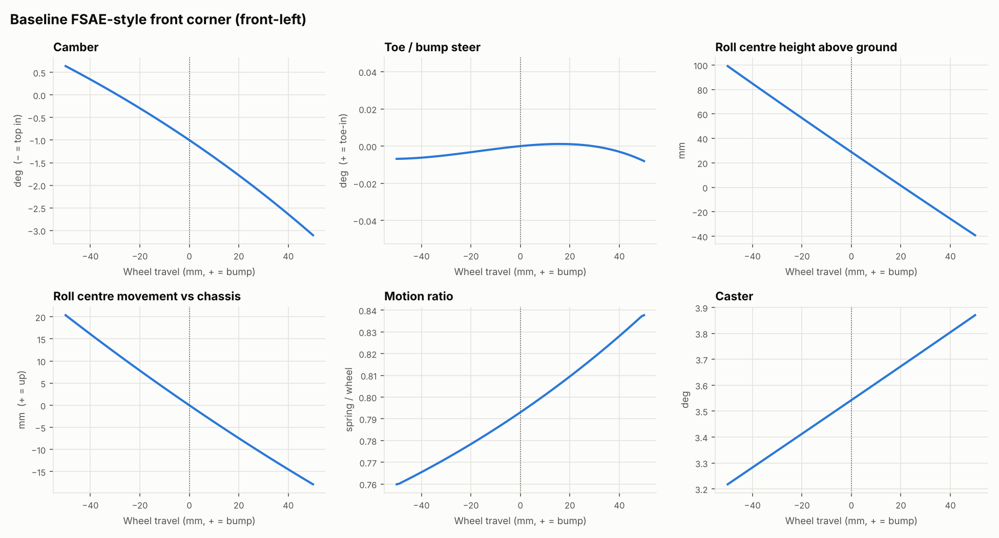

# suspension-kinematics

A personal simulation, analysis and design project: a parametric
**double-wishbone suspension kinematics solver** in Python, with an Autodesk
Fusion script (planned) that draws the result in CAD. The reference geometry
uses Formula SAE-sized dimensions because they are well documented and
realistic for a small open-wheel car.

Change a hardpoint in a JSON file, re-run one command, and get camber, toe,
caster, KPI, scrub, roll centre and motion ratio over the full wheel travel,
with no manual remodelling.



<p align="center"></p>

## Quick start

```bash
git clone https://github.com/EthanDiaz10/suspension-kinematics.git
cd suspension-kinematics
python -m venv .venv
# Windows:      .venv\Scripts\activate
# macOS/Linux:  source .venv/bin/activate
pip install -e ".[dev]"

suspkin sweep data/baseline_fsae_front.json   # writes CSV, JSON and plots to results/
pytest                                         # run the tests
```

Output for the baseline:

```
camber_gain_deg_per_10mm        -0.371
bump_steer_deg_per_10mm         +0.002
caster_deg                      +3.542
kpi_deg                         +5.440
scrub_radius_mm                +23.095
mech_trail_mm                  +12.738
roll_center_height_mm          +28.825
motion_ratio                    +0.793
```

Or from Python / a notebook (see `notebooks/01_bump_sweep.ipynb`):

```python
import suspkin as sk
hp = sk.load_hardpoints("data/baseline_fsae_front.json")
hp.chassis["UAF"][2] += 10           # try a design change
metrics = sk.compute_metrics(sk.bump_sweep(hp, travel_mm=50))
sk.plot_sweep(metrics, "my_change.png")
```

## Repository layout

| Folder | What lives there |
|---|---|
| `solver/suspkin/` | The Python package: hardpoint loading, the solver, metrics, plots, CLI |
| `data/` | Hardpoint sets as JSON. Copy the baseline to start a new design |
| `tests/` | `pytest` checks (link lengths preserved, sign conventions, etc.) |
| `notebooks/` | Jupyter notebooks for exploring designs |
| `cad/fusion/` | Fusion script that reads solver output (Phase 3) |
| `docs/images/` | Plots used in this README |

The solver and the CAD script only talk through files (`*_poses.json`), so
each can change without breaking the other.

## Conventions

* **Units:** millimetres and degrees.
* **Axes (SAE/ISO):** +X forward, +Y left, +Z up. Origin on the ground, on the
  car centreline, at the front axle line. We model the **front-left** corner.
* **Signs:** negative camber = top of tyre leans in; positive toe = toe-in;
  positive caster = upper ball joint behind lower; positive scrub = steering
  axis hits the ground inboard of the contact patch.

### Hardpoints

| Chassis (fixed) | | Upright (moves as one rigid body) | |
|---|---|---|---|
| `UAF` / `UAA` | upper arm front / aft pivot | `UBJ` | upper ball joint |
| `LAF` / `LAA` | lower arm front / aft pivot | `LBJ` | lower ball joint |
| `RTI` | tie rod inner (rack) | `RTO` | tie rod outer (steering arm) |
| `SHC` | spring/damper chassis end | `SHU` | spring/damper upright end |
| | | `WC` / `CP` | wheel centre / contact patch |

The baseline is a made-up but realistic FSAE-sized front corner, not a real car. The tie
rod inner point was placed with a quick grid search so bump steer is close to
zero, which is a preview of what Phase 2 automates.

## How the solver works

The upright is a rigid body, so its pose is 6 numbers: a **rotation vector**
(3, avoids Euler-angle gimbal lock) and a **translation** (3). Six equations
pin them down:

1. to 5. each of the five links (4 wishbone legs and the tie rod) keeps its design length;
6. the wheel centre sits at the requested height (design + travel).

`scipy.optimize.least_squares` solves these at every step from −50 to +50 mm,
starting each step from the previous answer. The tests check that every link
length is preserved to within 0.000001 mm at every pose.

**Current simplifications:** the spring/damper is modelled as direct acting
(the pushrod and rocker come later), the contact patch moves rigidly with the
upright (no tyre deflection), and the roll centre is for pure heave of a
symmetric car.

## Working on more than one PC

Git keeps every PC in sync through GitHub. Set up each PC once:

```bash
git clone https://github.com/EthanDiaz10/suspension-kinematics.git
cd suspension-kinematics
python -m venv .venv && pip install -e ".[dev]"   # activate .venv first, as above
```

Then every session follows the same routine:

```bash
git pull                      # 1. START: get what you did on the other PC
# ... edit, run, test ...
git add -A
git commit -m "Raise upper arm pivots 10 mm"
git push                      # 2. FINISH: send it up for the other PC
```

Tips:

* Always `git pull` before you start and `git push` before you walk away. That
  alone avoids almost all conflicts.
* `.venv/` and `results/` are not synced on purpose (see `.gitignore`). Each PC
  builds its own environment, and results can be regenerated in seconds.
* If `git pull` says there is a conflict, open the file, keep the lines you
  want, delete the `<<<<<<<`, `=======` and `>>>>>>>` markers, then
  `git add` the file and `git commit`.
* For a risky experiment, use a branch: `git switch -c try-longer-upper-arm`.
  Merge it back if you like it, delete it if not.

## Roadmap

- [x] **Phase 1:** repo scaffold, baseline hardpoints, bump sweep, camber/toe and other metrics, tests
- [ ] **Phase 2:** optimisation, nudging chosen hardpoints to hit targets (camber gain, bump steer, roll centre height and migration) within packaging limits
- [ ] Steering sweep and Ackermann percentage
- [ ] Pushrod and rocker stage (motion ratio through the rocker)
- [ ] Anti-dive / anti-squat (side-view geometry)
- [ ] Roll sweep (left and right corners moving opposite ways)
- [ ] **Phase 3:** Fusion script that draws the skeleton and tubes from `*_poses.json`

## License

MIT, see [LICENSE](LICENSE).
