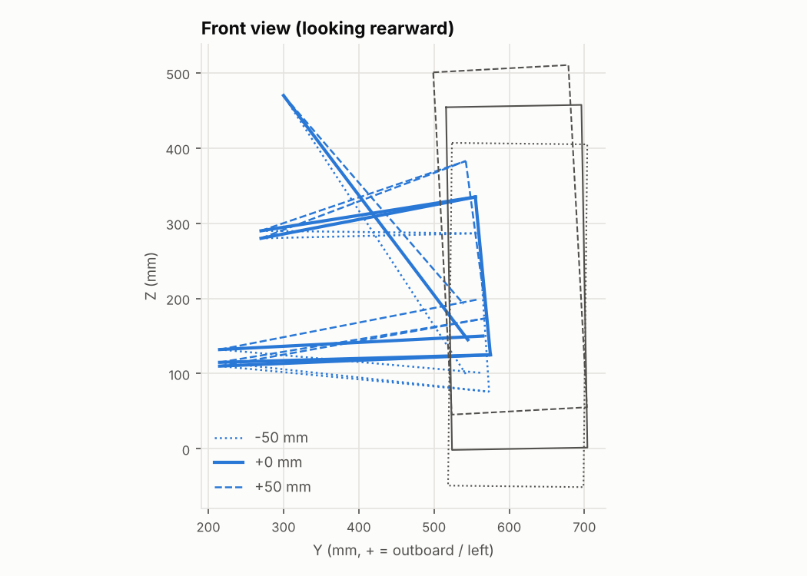
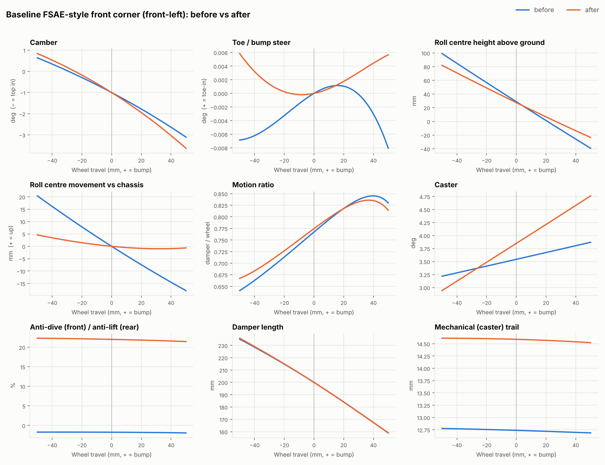
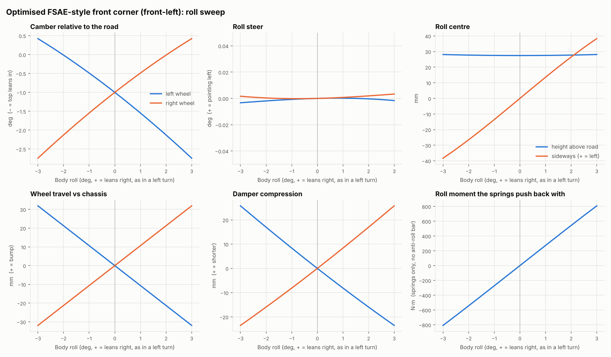
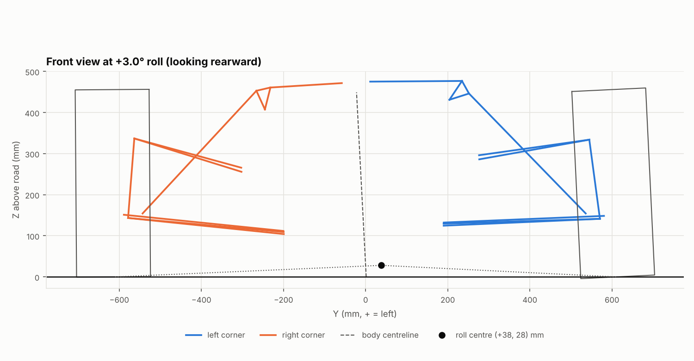

# suspension-kinematics

A personal simulation, analysis and design project: a parametric
**double-wishbone suspension kinematics solver** in Python, with an Autodesk
Fusion script that builds the result in CAD and exports STEP. The reference geometry
uses Formula SAE-sized dimensions because they are well documented and
realistic for a small open-wheel car.

Change a hardpoint in a JSON file, re-run one command, and get camber, toe,
caster, KPI, scrub, trail, roll centre, motion ratio through a pushrod and
rocker, and anti-dive over the full wheel travel, plus steering angles and
Ackermann over the full rack travel, and roll camber, roll steer, the roll
centre and roll stiffness as the body rolls, with no manual remodelling. Or let the optimiser move the hardpoints for you,
toward targets you set, while keeping the joints inside a 10" rim.


<p align="center"></p>

## Quick start

```bash
git clone https://github.com/EthanDiaz10/suspension-kinematics.git
cd suspension-kinematics
python -m venv .venv
# Windows:      .venv\Scripts\activate
# macOS/Linux:  source .venv/bin/activate
pip install -e ".[dev]"

suspkin sweep data/baseline_fsae_front.json   # writes CSV, JSON and plots to results/
suspkin steer data/baseline_fsae_front.json   # steering sweep and Ackermann
suspkin roll data/baseline_fsae_front.json    # body roll: both corners at once
suspkin check data/baseline_fsae_front.json   # do the joints fit inside the rim?
suspkin optimize data/baseline_fsae_front.json data/optimize_front.json   # ~2 minutes
pytest                                         # run the tests
```

Output for the baseline (`suspkin sweep`, trimmed):

```
camber_gain_deg_per_10mm                -0.371
bump_steer_deg_per_10mm                 +0.001
caster_deg                              +3.542
kpi_deg                                 +5.440
scrub_radius_mm                        +23.095
mech_trail_mm                          +12.738
roll_center_height_mm                  +28.825
rc_migration_vs_chassis_mm_per_mm       -0.383
motion_ratio                            +0.767
motion_ratio_change_droop_to_bump       +0.189
damper_travel_mm                       +76.046
anti_dive_pct                           -1.726
rocker_rotation_deg                    +87.723
Rocker layout at ride height:
  pushrod_to_rocker_arm_deg                 89.9
  damper_to_rocker_arm_deg                 100.0
```

Or from Python / a notebook (see `notebooks/01_bump_sweep.ipynb`):

```python
import suspkin as sk
hp = sk.load_hardpoints("data/baseline_fsae_front.json")
hp.chassis["UAF"][2] += 10           # try a design change
metrics = sk.compute_metrics(sk.bump_sweep(hp, travel_mm=50))
sk.plot_sweep(metrics, "my_change.png")
```

## Repository layout

| Folder | What lives there |
|---|---|
| `solver/suspkin/` | The Python package: hardpoint loading, the solver, pushrod/rocker stage, metrics, side-view, steering and roll analysis, rim packaging check, optimiser, plots, CLI |
| `data/` | Hardpoint sets and optimiser settings as JSON. Copy the baseline to start a new design |
| `tests/` | `pytest` checks (link lengths preserved, sign conventions, rim clashes, optimiser) |
| `notebooks/` | Jupyter notebooks for exploring designs |
| `cad/fusion/` | Fusion script that builds the sketch, tubes and joints from solver output and exports STEP ([how to run it](cad/fusion/README.md)) |
| `docs/images/` | Plots used in this README |

The solver and the CAD script only talk through JSON files (hardpoints or
`*_poses.json`), so each can change without breaking the other.

## Conventions

* **Units:** millimetres and degrees.
* **Axes (SAE/ISO):** +X forward, +Y left, +Z up. Origin on the ground, on the
  car centreline, at the front axle line. We model the **front-left** corner.
* **Signs:** negative camber = top of tyre leans in; positive toe = toe-in;
  positive caster = upper ball joint behind lower; positive scrub = steering
  axis hits the ground inboard of the contact patch.

### Hardpoints

| Chassis (fixed) | | Upright (moves as one rigid body) | |
|---|---|---|---|
| `UAF` / `UAA` | upper arm front / aft pivot | `UBJ` | upper ball joint |
| `LAF` / `LAA` | lower arm front / aft pivot | `LBJ` | lower ball joint |
| `RTI` | tie rod inner (rack) | `RTO` | tie rod outer (steering arm) |
| `SHC` | damper chassis end | `WC` / `CP` | wheel centre / contact patch |

| Pushrod and rocker (`"rocker"` block) | |
|---|---|
| `PRO` | pushrod outer end, on a bracket on the lower A-arm |
| `PRI` | pushrod inner end, on the rocker |
| `RKP` | rocker pivot, on the chassis; `"axis"` gives the pivot direction |
| `SHR` | damper end on the rocker |

Files without a `"rocker"` block still work: they need an `SHU` point on the
upright and the damper is treated as bolted straight to it (the Phase 1
placeholder).

The baseline is a made-up but realistic FSAE-sized front corner, not a real car,
with −1° static camber. `data/optimized_front.json` is the same corner after
running the optimiser (see below).

### Rim packaging

The ball joints and tie rod end sit inside the wheel rim, so the rim limits
where they can go. Each hardpoints file has a `"packaging"` block describing a
10" rim. `suspkin check` reports, for each joint, how far it is from the rim
barrel (radial margin) and from the hub mounting face. Because the upright and
wheel move together, this only needs checking at the design position.

## How the solver works

The upright is a rigid body, so its pose is 6 numbers: a **rotation vector**
(3, avoids Euler-angle gimbal lock) and a **translation** (3). Six equations
pin them down:

1. to 5. each of the five links (4 wishbone legs and the tie rod) keeps its design length;
6. the wheel centre sits at the requested height (design + travel).

`scipy.optimize.least_squares` solves these at every step from −50 to +50 mm,
starting each step from the previous answer. The tests check that every link
length is preserved to within 0.000001 mm at every pose.

Then the pushrod and rocker are solved (see below), which doesn't feed back
into the upright.

**Current simplifications:** the contact patch moves rigidly with the upright
(no tyre deflection), the roll centre is for pure heave of a symmetric car,
and parts are rigid (no compliance in bushes or the rocker).

## Optimisation (Phase 2)



`suspkin optimize` moves chosen hardpoints to hit targets. Everything is set in
`data/optimize_front.json`:

* **Variables:** which points move, along which axis, and how far (mm). For
  example `"upper inner pivots z"` moves both upper-arm chassis pivots up or
  down together by up to 25 mm.
* **Goals:** each has a `target`, a `scale` (how far off counts as one unit
  of bad) and a `weight` (how much you care). The score is
  `sum(weight × ((achieved − target) / scale)²)` and lower is better.
* **Hard limits:** the variable bounds, and every joint must fit in the rim.

| Goal | Meaning | Target | Baseline | Optimised |
|---|---|---|---|---|
| `rc_migration` | roll-centre movement relative to the chassis, per mm of travel | 0 | −0.38 | −0.05 |
| `rc_height` | static roll-centre height (mm) | 30 | 28.8 | 28.0 |
| `camber_gain` | camber change per 10 mm of bump (deg) | −0.40 | −0.37 | −0.45 |
| `bump_steer` | toe change over ±50 mm (deg) | 0 | 0.009 | 0.019 |
| `bj_spread` | distance between the ball joints (mm), for joint and arm loads | 210 | 211 | 195 |
| `kpi` | kingpin inclination (deg) | 5.5 | 5.4 | 5.9 |

(These "optimised" numbers are the optimiser's own output. The file has since
had the Phase 4 anti-dive and Ackermann changes applied, which move RC height
to 27.5 mm and bump steer to 0.007°; see Phase 4 below.)

Two more goals are available but not switched on in the default config:
`motion_ratio` (static damper/wheel ratio) and `anti_dive` (%). Rocker points
(`PRO`, `PRI`, `RKP`, `SHR`, `SHC`) can be used as variables too.

**Why roll-centre movement is measured against the chassis.** The centre of
gravity rides on the chassis. If the roll centre stays put on the chassis, the
lever arm between them (which sets how much the car rolls) stays the same as
the car rises and falls. Measured from the ground instead, even a perfectly
fixed roll centre "drops" 1 mm per mm of bump, which is why the
"height above ground" plot still slopes after optimising.

**Things to know:**

* The optimiser (`scipy.optimize.minimize`, SLSQP) walks downhill from the
  starting geometry. It finds a good design nearby, not necessarily the best
  one possible. Different bounds or a different starting design can give a
  different answer.
* "Iteration limit reached" just means it used its full 100-iteration budget.
  The score had already dropped from 235 to about 10.
* Variables that finish **at a bound** are printed with a marker. The
  optimiser wanted to go further, so think about whether that bound is real
  (packaging, chassis tubes) or can be widened.
* It only knows about the goals you give it, and goals pull against each
  other. Without the `bj_spread` and `kpi` goals, the same run cut RC
  migration to −0.006 but squeezed the ball joints from 211 to 172 mm apart
  and raised KPI to 6.6°. With them it settles at −0.05 with the joints
  195 mm apart. The upper ball joint is already against the rim, so the
  lower one is the only joint that can move, and lowering it fights the RC
  goal. The weights decide where that balance lands.

## CAD model in Fusion (Phase 3)

`cad/fusion/SuspensionModel/` is a Fusion script. Point it at
`data/optimized_front.json` (or a `*_poses.json` sweep, at any wheel travel)
and it opens a new design with a master 3D sketch of every hardpoint and link,
tubes with ball joints and rod ends, a see-through reference tyre, and writes
a STEP file. Install and run steps are in [cad/fusion/README.md](cad/fusion/README.md).

## Pushrod, rocker, anti-dive and Ackermann (Phase 4)

### Pushrod and rocker

The front view at the top of this page shows the layout. The pushrod runs from a bracket on the lower A-arm (`PRO`) up to a rocker,
which turns about a fixed axis on the chassis and pushes the damper. It is
solved in two small steps after the upright (`solver/suspkin/rocker.py`):

1. The lower arm is a rigid body turning about its two chassis pivots, so its
   rotation angle comes from where the lower ball joint went. `PRO` turns by
   the same angle.
2. The rocker can only spin about its axis, so `PRI` moves on a circle, and
   the pushrod says `PRI` must sit on a sphere of fixed radius around `PRO`.
   A circle meets a sphere in at most two points, found exactly with a bit of
   trigonometry (`A cos θ + B sin θ = C`). The one nearest the previous step
   is the real one.

The damper length is then `|SHR − SHC|`, and the **motion ratio** is
damper travel / wheel travel. Wheel rate = spring rate × MR². Some books call
this the installation ratio, and some define the motion ratio the other way
up (wheel / damper), so check which one a reference means before comparing.
Set `"pushrod_mount"` to `"upper_arm"` for a pullrod, or `"upright"` to mount
it on the upright.

The baseline has MR 0.77 at ride height, rising from 0.64 in full droop to
0.83 in bump (progressive), and the damper moves 38 mm over ±25 mm of wheel
travel. `suspkin sweep` also prints a few layout checks: the pushrod should
meet its rocker arm near 90° (near 0° or 180° the rocker is close to
locking), and the pushrod and damper should sit in the rocker's plane.

### Side view: anti-dive and caster trail

As the wheel moves, the upright swings about the **side-view instant centre**.
Where that point sits decides how much of the braking weight transfer goes
through the arms instead of the springs, which is **anti-dive** (front) or
anti-lift / anti-squat (rear). The solver finds it from the actual 3D motion of
the wheel centre and contact patch, not a hand construction; a test checks it
against the textbook method of drawing lines through the ball joints parallel
to each arm's pivot axis.

The anti percentages need a few whole-car numbers, set in the `"vehicle"`
block of the hardpoints file: wheelbase, CG height, front brake bias, inboard
or outboard brakes, and whether the axle is driven. Mechanical trail (caster
trail) is in the sweep output too.

The baseline has about −2% anti-dive (very slightly pro-dive): its arm pivots
are nearly level in side view. Lowering the lower arm's front pivot 5 mm and
raising its rear pivot 5 mm gives about 19% (see *Applied to the optimised
design* below).

### Steering and Ackermann


`suspkin steer` moves the rack from −25 to +25 mm and reports both wheels'
steer angles and the **Ackermann percentage** (100% = the inside wheel turns
exactly enough for both wheels to circle the same point at low speed, 0% =
both wheels turn the same, below 0 = the outside wheel turns more). Only the
left corner is modelled: the right wheel is its mirror image, so the right
wheel at rack +r is the mirrored left wheel at rack −r. A test builds a real
mirrored right corner and checks this gives identical angles.

The baseline is about −13% Ackermann (slightly anti-Ackermann) with 22° to
23° of lock at 25 mm of rack and a ~3.7 m turning radius. With the rack ahead
of the axle, moving the outer tie-rod end (`RTO`) outboard angles the steering
arm out and adds Ackermann: 20 mm further out takes it from −13% to about
+20%, at the cost of a little
more bump steer (0.2° over ±50 mm), so the rack height would need re-tuning
with it.

Race cars often run well under 100% Ackermann, because at speed the loaded
outside tyre works at a bigger slip angle. It's a tuning choice.

### Applied to the optimised design

`data/optimized_front.json` now carries both changes on top of the Phase 2
optimiser result (the baseline is left as it was, as the "before"):

| Change | Why |
|---|---|
| Lower-arm front pivot (`LAF`) 5 mm down, rear pivot (`LAA`) 5 mm up | anti-dive |
| Outer tie-rod end (`RTO`) 20 mm outboard | Ackermann |
| Rack (`RTI`) 0.6 mm outboard and 0.7 mm down | cancels the bump steer the `RTO` move added |

| | Before | After |
|---|---|---|
| Anti-dive | −0.6% | 22% |
| Ackermann at full lock | −16% | +17% |
| Toe change over ±50 mm (bump steer) | 0.019° | 0.007° |
| Camber gain per 10 mm | −0.445° | −0.442° |
| Roll-centre height | 28.0 mm | 27.5 mm |
| Roll-centre movement vs chassis | −0.051 | −0.055 |
| `RTO` clearance to the rim barrel / hub face | | 5.9 mm / 6.4 mm |

Caster, KPI, scrub, trail and motion ratio don't change. The rack position was
found with a quick two-variable search for the smallest toe change over the
sweep. The `RTO` move uses up most of the room left inside the rim, so it's
about as far as it can go there.

## Roll sweep (Phase 5)



<p align="center"></p>

`suspkin roll` leans the body from −3° to +3° and solves **both** front
corners at once (`solver/suspkin/roll.py`). As in the steering sweep, only the
left corner is modelled: the right wheel in bump is the left corner solved at
the same bump travel and mirrored, and a test checks this against a real
mirrored right corner.

How a roll angle is set up: the two wheels move equal and opposite amounts
relative to the chassis (left down, right up), which with equal springs keeps
the total spring force about the same, so the car rolls without heaving. The
road is the line through the two contact patches, and a 1D root finder picks
the wheel travel that tilts that line by exactly the requested angle.

Positive roll means the body leans right, as in a **left** turn (the same
"left is positive" rule as the steering sweep), so the right wheel is the
outside wheel. What it reports:

| Output | Meaning |
|---|---|
| Roll camber | camber change relative to the **road** per degree of roll. A wheel that simply leaned with the body would be +1°/° on the outside wheel. |
| Camber compensation | how much of that the camber gain in bump cancels: 0% = leans with the body, 100% = stays upright to the road |
| Roll steer | steer change per degree of roll; below 0 at the front = steers out of the turn = roll understeer |
| Roll centre | where the lines from each contact patch through its instant centre cross. With the car rolled it moves sideways as well as up and down |
| Wheel / damper travel per degree | from the solved poses; their ratio is the motion ratio |
| Roll stiffness | springs only (no anti-roll bar, rigid tyres), from the spring energy `½k(x_L² + x_R²)`, so a rising-rate rocker is included. A test checks it against the textbook `k·MR²·track²/2` |
| Body heave | how much the body rises or sinks as it rolls (jacking) |

The spring rate comes from `"spring_rate_n_per_mm"` in the `"vehicle"` block
(35 N/mm, about 200 lb/in, is a made-up placeholder), or `--spring-rate` on
the command line.

| ±3° roll | Baseline | Optimised |
|---|---|---|
| Roll camber, outside wheel | +0.61°/° | +0.53°/° |
| Camber compensation | 39% | 47% |
| Outside-wheel camber at 3° roll | +0.72° | +0.42° |
| Roll steer | 0.001°/° | 0.000°/° |
| Roll centre height (static → 3°) | 28.8 → 24.2 mm | 27.5 → 28.1 mm |
| Roll centre sideways movement | 86 mm/° | 14 mm/° |
| Wheel / damper travel | 10.6 / 8.2 mm/° | 10.6 / 8.2 mm/° |
| Roll stiffness (35 N/mm springs) | 268 N·m/° | 273 N·m/° |

The optimiser's roll-centre migration goal (Phase 2) pays off here: the
optimised roll centre barely moves sideways, so the roll moment arm stays the
same through a corner. Even so, the outside tyre goes from −1° static camber
to about +0.4° at 3° of roll, which costs grip. More static camber, or a
shorter upper arm for more camber gain, would help.

## Working on more than one PC

Git keeps every PC in sync through GitHub. Set up each PC once:

```bash
git clone https://github.com/EthanDiaz10/suspension-kinematics.git
cd suspension-kinematics
python -m venv .venv && pip install -e ".[dev]"   # activate .venv first, as above
```

Then every session follows the same routine:

```bash
git pull                      # 1. START: get what you did on the other PC
# ... edit, run, test ...
git add -A
git commit -m "Raise upper arm pivots 10 mm"
git push                      # 2. FINISH: send it up for the other PC
```

Tips:

* Always `git pull` before you start and `git push` before you walk away. That
  alone avoids almost all conflicts.
* `.venv/` and `results/` are not synced on purpose (see `.gitignore`). Each PC
  builds its own environment, and results can be regenerated in seconds.
* If `git pull` says there is a conflict, open the file, keep the lines you
  want, delete the `<<<<<<<`, `=======` and `>>>>>>>` markers, then
  `git add` the file and `git commit`.
* For a risky experiment, use a branch: `git switch -c try-longer-upper-arm`.
  Merge it back if you like it, delete it if not.

## Roadmap

- [x] **Phase 1:** repo scaffold, baseline hardpoints, bump sweep, camber/toe and other metrics, tests
- [x] **Phase 2:** optimisation, nudging chosen hardpoints to hit targets (camber gain, bump steer, roll centre height and migration) within 10" rim packaging limits
- [x] **Phase 3:** Fusion script: master 3D sketch, tube solids with ball joints and rod ends, STEP export, from hardpoints or `*_poses.json`
- [ ] Optimiser goal for scrub radius and mechanical trail
- [x] **Phase 4:** pushrod and rocker stage (motion ratio, rocker layout checks), side-view instant centre with anti-dive / anti-squat, steering sweep with Ackermann, rocker and damper in the Fusion script
- [ ] Optimiser goals for Ackermann (needs a steering sweep inside the loop)
- [x] **Phase 5:** roll sweep: both corners at once, roll camber and steer, roll centre under roll, roll stiffness from the springs
- [ ] Rear corner hardpoints (anti-squat, driven axle)
- [ ] Anti-roll bar, and roll gradient (deg/g) and roll stiffness distribution once the rear corner exists

## License

MIT, see [LICENSE](LICENSE).
