# Full design notes: a made-up FSAE-style car

The long version of the [design report](design-report.md), with every hardpoint, table and
step of how the design got where it is.

A complete front and rear double-wishbone suspension, from hardpoints to CAD. Every
number here comes from the tools in this repo, so any of them can be re-run and
checked. It's a personal design project. The car is made up, but it's sized like a
Formula SAE car, because those cars are well documented and realistic.

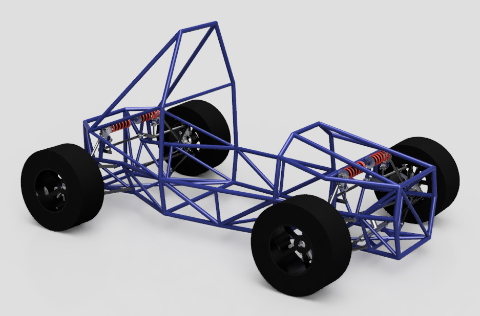

*The whole car, rendered in Autodesk Fusion. The model is built by
`cad/fusion/CarAssembly` from `suspkin assembly`: four corners, both anti-roll bars,
the steering rack, wheels and a tube space frame.*

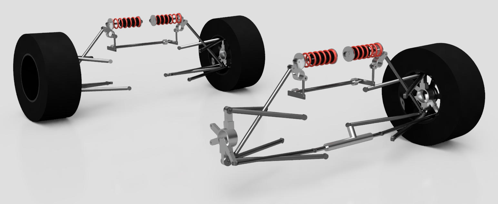

*The same car with the frame hidden and the front-left wheel removed. You can see the
upright, the wishbones meeting it, the pushrod running up to the rocker, and the
damper and spring lying across the top.*

---

## 1. Summary

| | Front | Rear |
|---|---|---|
| Layout | Double wishbone, pushrod to a rocker, U-bar anti-roll bar | Same, toe link instead of a tie rod, driven |
| Track | 1220 mm | 1200 mm |
| Static camber / toe | -1.75° / 0° | -1.75° / 0° |
| Camber gain | -0.38° per 10 mm bump | -0.36° per 10 mm bump |
| Bump steer (toe change over ±50 mm) | 0.001° | 0.002° |
| Roll centre height / movement vs chassis | 17 mm / -0.04 mm/mm | 25 mm / -0.02 mm/mm |
| Caster / KPI | 4.0° / 6.2° | 0° / 6.2° |
| Scrub radius / mechanical trail | 19.6 mm / 15.0 mm | 14.2 mm / 0 |
| Anti-dive / anti-squat / anti-lift | 23% anti-dive | 25% anti-squat, 9% anti-lift |
| Ackermann | +17% at full lock (24° inner wheel) | |
| Motion ratio (damper / wheel) | 0.78, mildly rising | 0.77, mildly rising |
| Spring / wheel rate | 35 / 21.2 N/mm | 40 / 23.4 N/mm |
| Ride frequency | 2.85 Hz | 2.83 Hz |
| Roll stiffness (springs + bar) | 275 + 194 = 469 N·m/° | 295 + 112 = 407 N·m/° |

| Whole car | |
|---|---|
| Mass, weight split, CG height | 280 kg with driver, 47% front, 290 mm |
| Wheelbase | 1550 mm |
| Roll gradient | 0.84°/g (1.27° at the 1.5 g design load) |
| Front share of lateral load transfer | 52% (front weight 47%: mild understeer) |
| Outside-tyre camber at 1.5 g | -1.02° front, -1.00° rear (target -1°) |
| Weakest link (safety factor) | Front lower wishbone rod end, 3.8 (required 1.5) |
| Weakest machined part | Front upright, ~150 MPa in Ansys, safety factor 3.4 (required 2) |
| Space frame | 126 tubes, 39.5 m, about 34 kg of 4130; no tube within 3 mm of a suspension part |

The design meets every target it was given. The two things I'd change next are in
section 10: the front inside tyre lifts at about 1.9 g, and the brake bias should
move forward.

---

## 2. The brief

There was no team or rulebook to answer to, so I wrote my own brief from typical
FSAE numbers:

| Item | Value | Why |
|---|---|---|
| Car + driver | 280 kg, 47% front | Typical single-seat combustion FSAE car |
| CG height | 290 mm | Low seat, engine low in the chassis |
| Wheelbase / tracks | 1550 / 1220 / 1200 mm | Within the usual range (rules minimum wheelbase 1525 mm) |
| Wheels | 10 inch rims, 7 inch wide tyres, 228 mm loaded radius | Light, and the most common FSAE choice. Also the hardest packaging case |
| Design lateral load | 1.5 g steady cornering | Realistic for a car on FSAE slicks |
| Load cases | Cornering 1.6 g, braking 1.6 g, combined, acceleration, 3 g bump | Section 7 |
| Brakes | Outboard, 65% front bias | Simple and common |

Targets, and why:

* **Outside tyre at -1° camber at 1.5 g.** The tyre makes the most grip a little
  negative, and the outside tyre does most of the work in a corner.
* **Roll centre low (20 to 30 mm) and fixed on the chassis.** A low roll centre keeps
  jacking forces small. If the roll centre doesn't move relative to the chassis,
  the car's roll behaviour stays the same as it rises and falls.
* **Bump steer close to 0.** The car shouldn't steer itself over bumps.
* **Camber gain around -0.4° per 10 mm.** This gets back some of the camber lost to
  body roll, without making the tyre camber swing too much over bumps.
* **Some anti-dive and anti-squat (20 to 30%).** This cuts pitch under braking and
  acceleration without making the steering or ride harsh.
* **Positive Ackermann.** Tight FSAE corners suit it.
* **Ride frequency about 2.5 to 3 Hz,** and a slightly understeering roll balance (front
  load transfer share a few points above the front weight share).
* **Every joint inside the 10 inch rim, with clearance.**

---

## 3. Architecture

| Choice | Reason |
|---|---|
| Unequal-length double wishbones | The best control of camber and roll centre for a given package. Every hardpoint is free to tune |
| Pushrod to a rocker (bellcrank), damper across the top of the chassis | The dampers sit in clean air, inside the frame, out of the tyre's way. The rocker sets the motion ratio. The pushrod mounts on the lower wishbone, so the upper wishbone carries no spring load |
| U-bar anti-roll bar driven from the rocker | It changes roll stiffness without changing ride. The drop link reuses the rocker, so no extra pickups are needed on the wishbones |
| Steering rack in front of the axle, tie rod at lower-wishbone height | Short, straight tie rods. Easy to tune bump steer by moving the inner end |
| Rear toe link behind the axle | Sets rear toe and keeps it nearly constant in bump |
| Outboard brakes, chassis-mounted diff | Simple. The brake torque goes through the upright's caliper lugs (section 8) |

---

## 4. Method

All the maths is in the Python package `suspkin` (`solver/suspkin/`). The Fusion
scripts in `cad/fusion/` only draw what the solver writes out.

1. **Kinematics.** The upright is a rigid body held by five fixed-length links (two
   per wishbone, plus the tie rod) and the wheel-centre height. The solver finds
   its position with a rotation vector and translation, using least squares and a
   warm start between steps. Worst residual is about 1e-13 mm. The rocker,
   pushrod and anti-roll bar are solved in a second stage, in closed form.
2. **Optimisation.** `suspkin optimize` moves chosen hardpoints within bounds to
   lower a weighted sum of squared misses from the targets. Every joint must stay
   inside the rim (a hard limit).
3. **Roll and whole car.** Both sides of an axle are solved as the body rolls.
   Roll stiffness from the springs and bar comes from the energy stored, and the
   front and rear axles combine into the roll axis, roll gradient and load
   transfer split.
4. **Loads.** For each load case, tyre forces give the force in each link from the
   upright's equilibrium (6 equations, 6 links). The rocker equilibrium then gives
   the damper, drop link and pivot loads.
5. **Parts.** The upright, rocker and bracket are built from the hardpoints out of
   cylinders and boxes, and checked three ways: hand calculations, a built-in FE
   model (gmsh + scikit-fem), and Ansys Student.
6. **CAD.** Fusion scripts build the corner, the parts, and the whole car with a
   space frame, then export STEP.

The tests (`pytest`, 184 of them, run on every push in GitHub Actions) check the
solver against things that must be true: link lengths stay constant, signs follow
the conventions, and virtual work balances (tyre load × wheel travel = damper force
× damper travel). They also check against independent sums, such as the bar torque
from the drop link force agreeing with the roll model.

---

## 5. Front corner

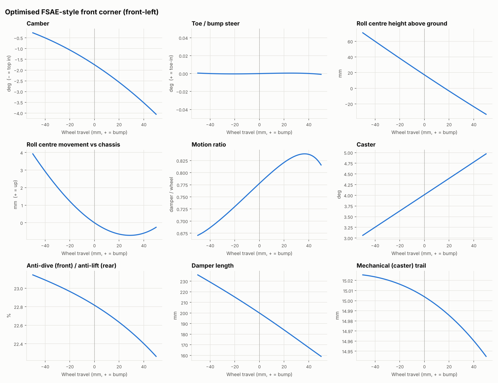

| Hardpoint (front left, mm) | x | y | z |
|---|---|---|---|
| Upper wishbone front / rear pivot (UAF / UAA) | 110 / -120 | 290 / 290 | 281.4 / 271.4 |
| Lower wishbone front / rear pivot (LAF / LAA) | 130 / -130 | 195 / 195 | 114.6 / 119.6 |
| Upper / lower ball joint (UBJ / LBJ) | -8 / 5 | 555 / 575 | 327.8 / 142.5 |
| Tie rod inner / outer (RTI / RTO) | 65 / 68 | 194.5 / 585 | 122.4 / 150.0 |
| Wheel centre (WC) | 0 | 610 | 228 |
| Pushrod on the wishbone / rocker (PRO / PRI) | 5 / 5 | 540 / 262.5 | 154.5 / 453.0 |
| Rocker pivot (RKP), axis along x | 5 | 225 | 420 |
| Damper on the rocker / chassis (SHR / SHC) | 5 / 5 | 234.6 / 34.6 | 474.2 / 474.2 |

Origin on the ground, on the centre line, at the front axle. +x forward, +y left,
+z up.

How it got here:

1. **Baseline** (hand-sketched FSAE geometry). Camber gain -0.37°/10 mm was fine,
   but the roll centre moved 0.38 mm for every mm of bump relative to the chassis.
2. **Optimiser** (Phase 2). The upper and lower pivots and the lower ball joint were
   free to move, with goals for roll centre migration, roll centre height, camber
   gain, bump steer, ball joint spread and KPI. Migration fell from -0.38 to -0.05.
   Without the spread and KPI goals it went even lower, but squeezed the ball
   joints from 211 to 172 mm apart, which doubles the arm loads. So those goals
   stayed in.
3. **Anti-dive and Ackermann** (Phase 4). The lower wishbone's front pivot moved
   5 mm down and its rear pivot 5 mm up, which took anti-dive from about 0 to 22%.
   The outer tie rod end moved 20 mm outboard, which took Ackermann from -16% to
   +17%. Then the rack moved 0.6 mm out and 0.7 mm down to cancel the bump steer
   the outer move added.
4. **Packaging fix** (Phase 9). A real spherical-bearing housing needs about 13 mm
   of radius at the upper ball joint, and it hit the rim. So the upper ball joint
   came down 6 mm. That cost about 10% of the camber gain (-0.43 to -0.38) and
   lowered the roll centre by about 7 mm. Static camber went to -1.75° to keep the
   outside tyre at -1° at 1.5 g.

Results at ride height: camber gain -0.38°/10 mm, toe change 0.001° over
±50 mm, roll centre 17 mm high and moving 0.04 mm per mm of bump relative to the
chassis, caster 4.0°, KPI 6.2°, scrub radius 19.6 mm, mechanical trail 15 mm, and
anti-dive 23%.

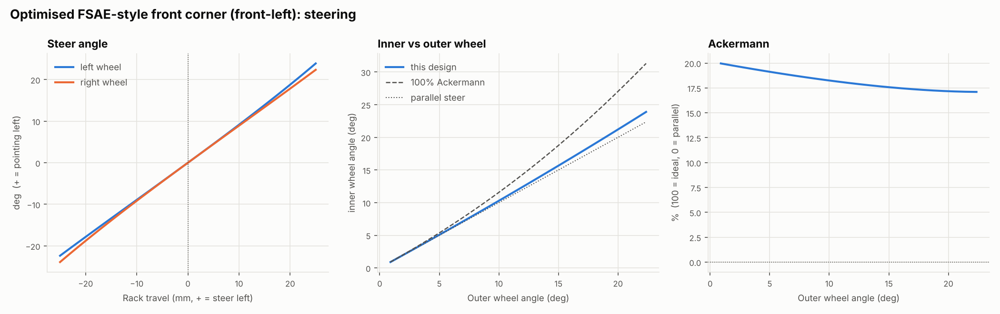

**Steering.** With ±25 mm of rack travel the inner wheel reaches 23.9° and the
outer 22.4°. That's +17% Ackermann and a 3.6 m turning radius. Moving the outer tie
rod end further outboard would add more Ackermann, but there's no room left inside
the rim.

**Motion ratio.** 0.78 at ride height, rising gently from 0.67 at full droop to
0.84 near full bump (slightly progressive), then easing off at the very end. The
rocker arms are within 2° of square to the pushrod and 10° of square to the damper
at ride height, which keeps the ratio well behaved.

---

## 6. Rear corner

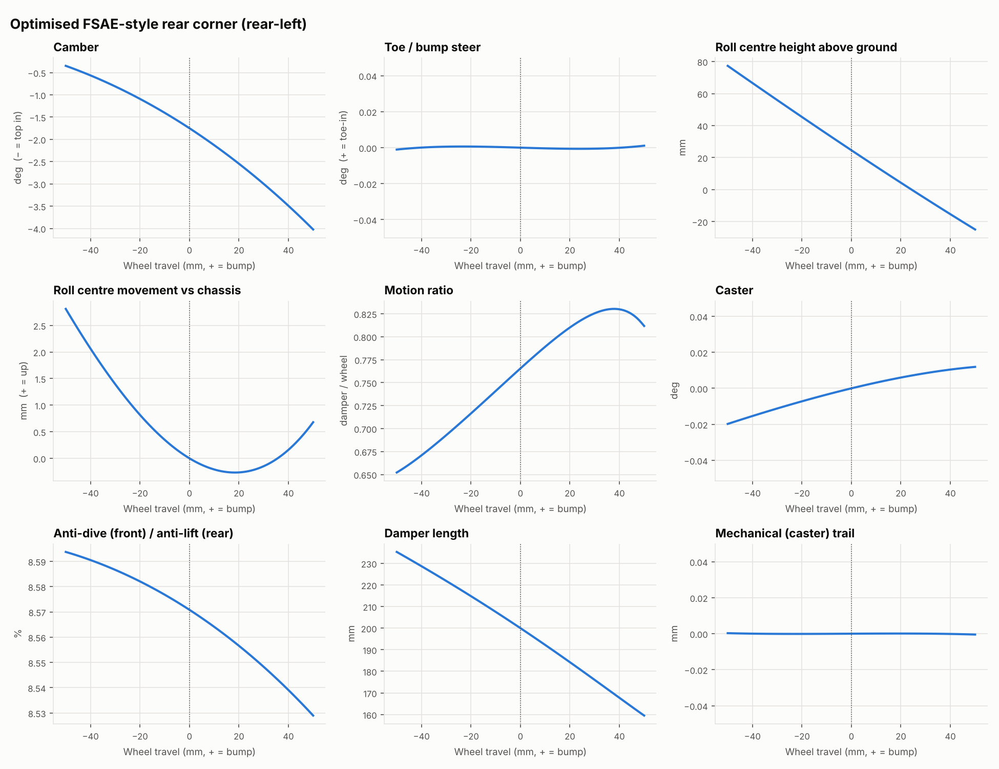

| Hardpoint (rear left, mm, origin at the rear axle) | x | y | z |
|---|---|---|---|
| UAF / UAA | 120 / -110 | 290 / 290 | 289.3 / 277.9 |
| LAF / LAA | 140 / -120 | 195 / 195 | 132.2 / 119.8 |
| UBJ / LBJ | 0 / 0 | 550 / 570 | 328.2 / 145.0 |
| Toe link inner / outer (RTI / RTO) | -70 / -70 | 196.8 / 565 | 129.6 / 150.0 |
| Wheel centre | 0 | 600 | 228 |
| Pushrod, rocker, damper | | same layout as the front | (PRO at y 530, z 157.5) |

The rear started from the same baseline and went through its own optimiser run.
That run had extra goals for **anti-squat** (from the wheel centre's path, because
the diff is on the chassis) and **toe change**. To give the side-view goals
something to work with, the optimiser could move each wishbone's front pivot on
its own.

| Rear | Baseline | Final |
|---|---|---|
| Anti-squat | -0.4% | 25% |
| Anti-lift (braking) | -0.1% | 9% |
| Toe change over ±50 mm | 0.13° | 0.002° |
| Roll centre migration vs chassis | -0.38 | -0.02 mm/mm |
| Roll centre height | 30 mm | 25 mm |
| Camber gain | -0.36 | -0.36°/10 mm |

The rear roll centre sits above the front one, so the roll axis rises toward the
rear, which is the usual layout.

---

## 7. Springs, anti-roll bars and the whole car in roll

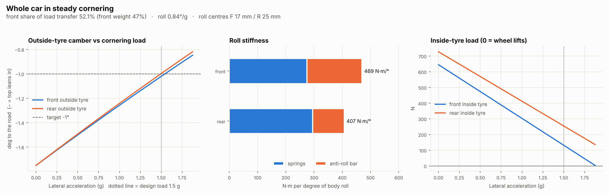

**Springs.** I picked the springs for ride frequency first. At 35 N/mm front and
40 N/mm rear, the wheel rates (spring rate × motion ratio²) are 21.2 and 23.4 N/mm.
With the corner masses that gives 2.85 and 2.83 Hz. That's typical for an FSAE car
with little downforce: stiff enough for small, controlled pitch and roll, soft
enough to ride the bumps on a car park track. The two axles are matched, so the
car doesn't pitch over bumps.

**Anti-roll bars.** With springs alone the car rolled about 1.0°/g, and the front
took only 39% of the load transfer. That's below its 47% weight share, which leans
the car toward oversteer. I chose the front bar (6.5 N·m/° torsional, 194 N·m/° of
roll stiffness at the wheels) to put the front share a few points above the weight
share. Then the rear bar (4.0 N·m/°) trimmed the balance once the real rear corner
existed.

| | Value |
|---|---|
| Roll gradient | 0.84°/g |
| Front share of lateral load transfer | 52.1% (front weight 47%) |
| Of that, through the links at the roll centres (instant) | 5.3% front, 9.5% rear |
| Outside-tyre camber at 1.5 g, front / rear | -1.02° / -1.00° |
| Inside-tyre load at 1.5 g, front / rear | 132 N / 255 N (static 645 / 728 N) |

The camber targets are met almost exactly. The static camber that would put each
outside tyre at exactly -1° is -1.73° front and -1.75° rear. The front inside tyre
is the one to watch: at 1.5 g it carries only a fifth of its static load, and it
would lift at about 1.9 g.

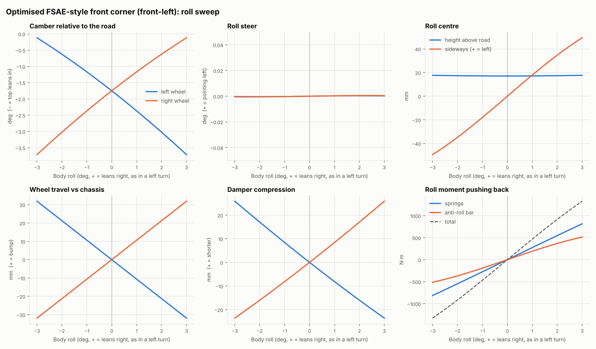

---

## 8. Loads and sizing

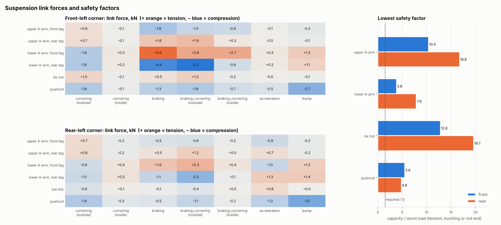

Seven load cases, using tyre forces from the whole-car model (rigid tyres, 20 mm
of pneumatic trail):

| Case | What it is |
|---|---|
| Cornering | 1.6 g steady, inside and outside wheels |
| Braking | 1.6 g, 65% front bias |
| Braking while cornering | 1.1 g each way (about 1.56 g combined, on the friction circle), inside and outside |
| Acceleration | 1.0 g, rear wheels driven |
| Bump | 3 g vertical at one wheel |

The worst link forces: the front lower wishbone takes 5.0 kN in tension (front
leg) and 5.2 kN in compression (rear leg) when braking. Pushrods peak at 2.7 kN
front and 3.1 kN rear in the 3 g bump.

| Member (tube) | Worst case | Yield SF | Buckling SF | Rod end SF |
|---|---|---|---|---|
| Front lower wishbone, rear leg (19.05 × 1.65) | Braking + cornering | 36 | 5.8 | **3.8** |
| Front lower wishbone, front leg | Braking | 7.8 | 19 | 4.0 |
| Front pushrod (15.9 × 1.24) | Bump | – | 6.1 | 5.6 |
| Rear pushrod | Bump | – | 5.5 | 4.8 |
| Everything else | | > 17 | > 12 | > 7.9 |

All members pass the required safety factor of 1.5. The rod end ratings are
typical catalogue values and would need checking against the actual parts. The
tool also finds the lightest catalogue tube that still passes. The arms could be
42 to 63% lighter, but I kept the 3/4 in tube for stiffness, damage tolerance and
easy welding. A tube sized only for strength is too fragile on a real car.

---

## 9. Parts and stress analysis

| Part (material, mass) | Worst case | Hand calc | Built-in FE | Ansys Student | Safety factor |
|---|---|---|---|---|---|
| Front upright (7075-T6, 509 g) | Braking + cornering | 136 MPa | 180-213 MPa (sharp corner) | **~150 MPa** | **3.4** |
| Rear upright (7075-T6, 517 g) | Acceleration | 89 MPa | 95 MPa | | 5.3 |
| Front / rear rocker (7075-T6, 106 g) | 3 g bump | 106 / 122 MPa | 145 / 167 MPa | | 3.5 / 3.0 |
| Front / rear pushrod bracket (4130, 25 g) | 3 g bump | 94 / 124 MPa | 77 / 99 MPa | | 5.6 / 4.4 |

The required safety factor here is 2 on yield. That's higher than the tubes'
1.5, because these are machined parts with holes and corners, and aluminium has no
fatigue limit.

**How the upright is held and loaded.** The bearing bore is fixed, and the joint
forces from the link solve go into the ball joint and steering arm holes. A wheel
bearing can't carry torque about the axle, so under braking the brake torque goes
through the two caliper lugs. The lug forces are worked out so their moment about
the axle equals the tyre's.

**What the Ansys study taught me.** With the corner between the steering arm and
the lower ball joint arm left sharp, refining the mesh sent the peak from 157 to
237 to 320 MPa, and it would never settle. A sharp inside corner is a stress
singularity. Its stress has no converged value, so the only fix is a real fillet.
After filleting it in Fusion the peak dropped to about 145-150 MPa. The deformation
(0.34 mm at the steering arm, about 0.03° of steer) stayed the same from 56k to
905k nodes. The full study is in [phase9-ansys-results.md](phase9-ansys-results.md).

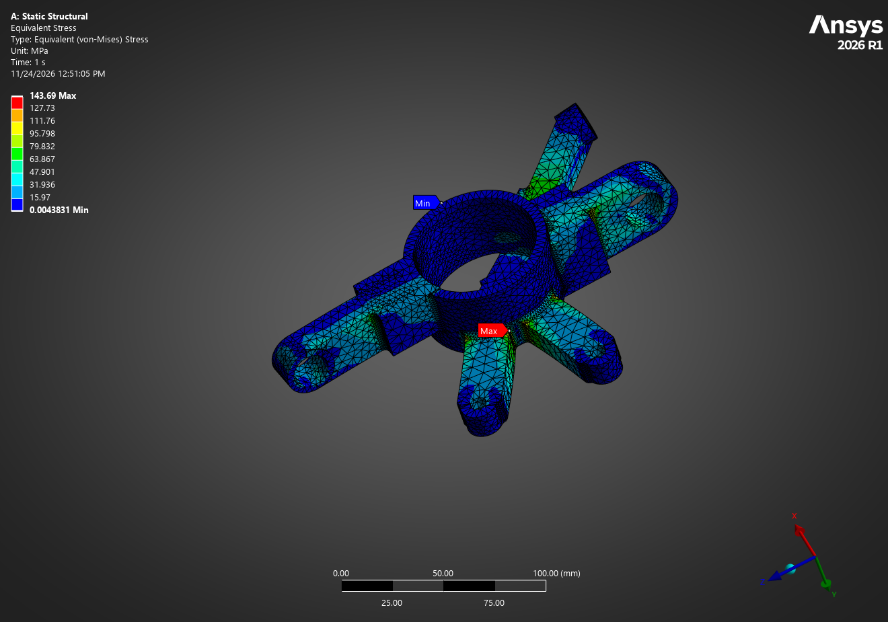

---

## 10. Packaging and the chassis

* **Inside the rim.** Every ball joint, the steering arm and the upright's
  solids are checked against the 10 inch rim's envelope, in the wheel's own frame.
  The tightest gap is 1.5 mm (upright to rim). The upper ball joint was lowered
  6 mm to get there.
* **Space frame** (`solver/suspkin/frame.py`). It's an FSAE-style tube frame with a front bulkhead,
  front and main hoops with braces, side impact tubes, and front and rear
  suspension boxes. That's 126 tubes, 39.5 m and about 34 kg of 4130, which is
  in the usual range for a steel FSAE frame. Every wishbone pickup sits on a short
  tab just outboard of a frame node, so each wishbone's load goes into tubes along
  their length instead of bending one. The rockers hang off a cross tube with a
  strut down to the upper rail.
* **Clearance check.** Every frame tube is checked against every suspension part
  (each treated as a round capsule). The first frame layout had tubes running
  through the tie rods, dampers and rod ends. Moving the pickup nodes inboard and
  down and rerouting the top rails outboard of the rockers cleared all of them.
  The closest gap now is about 5 mm, between the spring perches and the rocker
  cross tubes.

The frame is a packaging and visual model. It hasn't been checked against the
FSAE rules or for strength.

### Renders

| | |
|---|---|
| 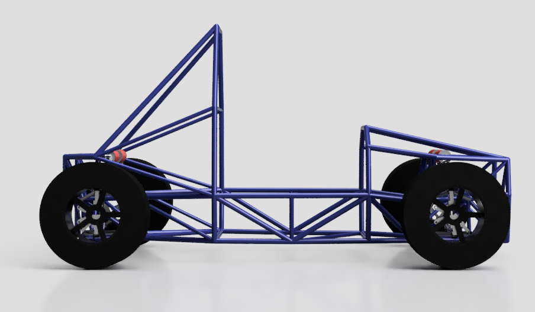 | 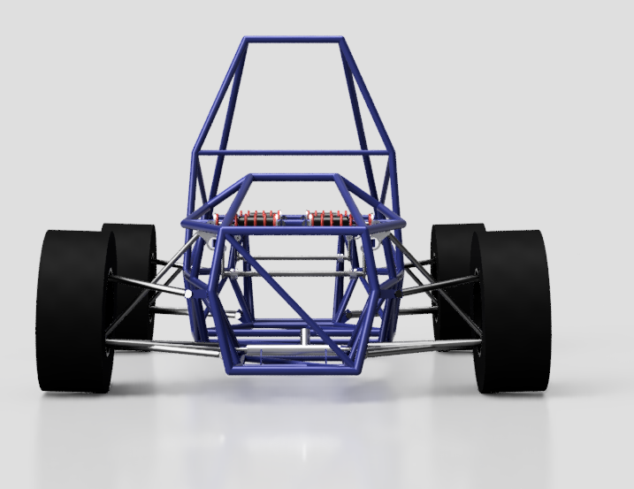 |
| *Side: 1550 mm wheelbase, front and main hoops* | *Front: wishbones, pushrods and the rocker cross tube* |
| 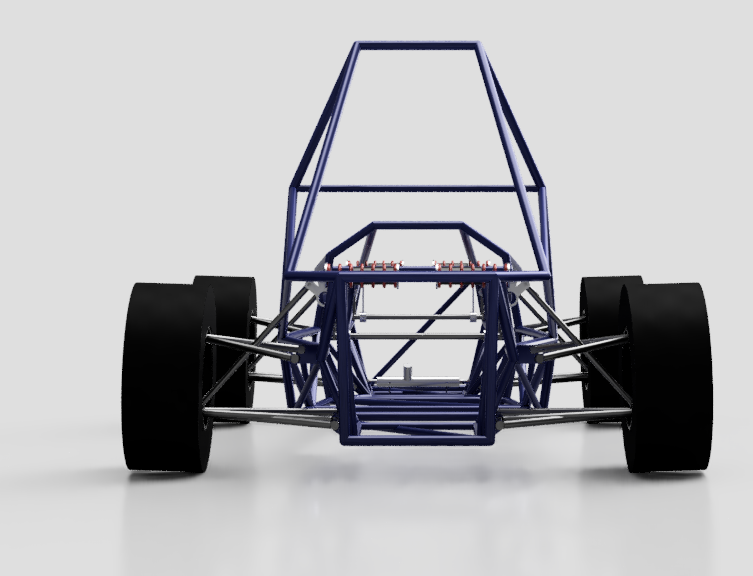 | 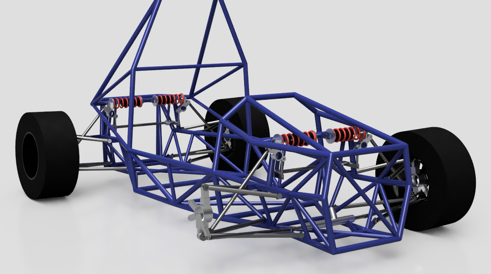 |
| *Rear* | *Front-left corner with the wheel removed: upright, wishbones, pushrod and bracket, tie rod and rack* |

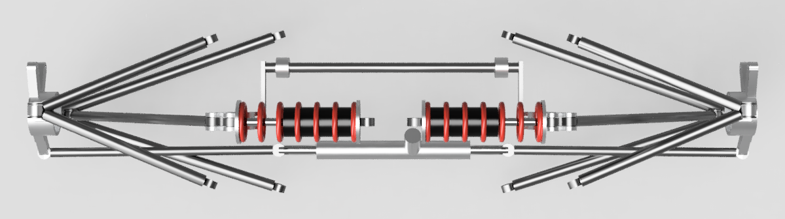

*Front suspension from above, frame and wheels hidden: the two dampers lying across the
car, the anti-roll bar behind them, the rack at the front, and the wishbones running out
to the uprights.*

---

## 11. Limitations and what I'd do next

What the models leave out:

* **Rigid tyres, rigid frame.** Real tyres deflect and have their own camber and
  slip response. A tyre model (even a simple linear one) would turn the camber and
  load transfer numbers into grip, and the next step would be a lap-time or
  steady-state handling model.
* **No compliance.** Rod ends, tabs and the upright deflect under load. The upright's
  0.34 mm costs about 0.03° of steer, which is small, but the whole corner's compliance
  steer would be worth estimating.
* **Clearance at ride height only.** The frame check should also run at full
  bump, full droop and full steering lock.
* **Made-up inputs.** Mass, CG, tyre radius, loads and rod end ratings are
  realistic placeholders, not measurements.

Design changes I'd make next:

1. **Brake bias forward.** At 1.6 g the ideal front bias is about 77%. At 65% the
   rear brakes lock first. A bias bar would let the driver tune it.
2. **Front inside tyre lift at about 1.9 g.** A slightly softer front bar, or
   moving a little roll stiffness to the rear, would delay it, at the cost of some
   understeer balance.
3. **Bump stop.** In the 3 g bump the damper is pushed 48 mm, more than its bump
   stroke. A bump stop has to catch it, and its stiffness sets the peak pushrod load.
4. **Lighter uprights.** At about 510 g they are heavy, and 350 to 450 g is
   typical. Pockets in the arms, checked in Ansys, are the next step.
5. **Joint loads at full bump,** not just ride height, since the link angles change.

---

## 12. Reproduce it

```bash
pip install -e ".[dev]"
suspkin sweep data/optimized_front.json        # kinematics, plots
suspkin steer data/optimized_front.json        # steering, Ackermann
suspkin car data/optimized_front.json data/optimized_rear.json     # roll, balance
suspkin loads data/optimized_front.json data/optimized_rear.json   # link forces, sizing
suspkin parts data/optimized_front.json data/optimized_rear.json   # parts, hand calcs
suspkin assembly data/optimized_front.json data/optimized_rear.json # whole car for Fusion
pytest
```

Then run `cad/fusion/CarAssembly` in Fusion for the model and the STEP file. The
[technical guide](technical-guide.md) explains each phase in more detail.
