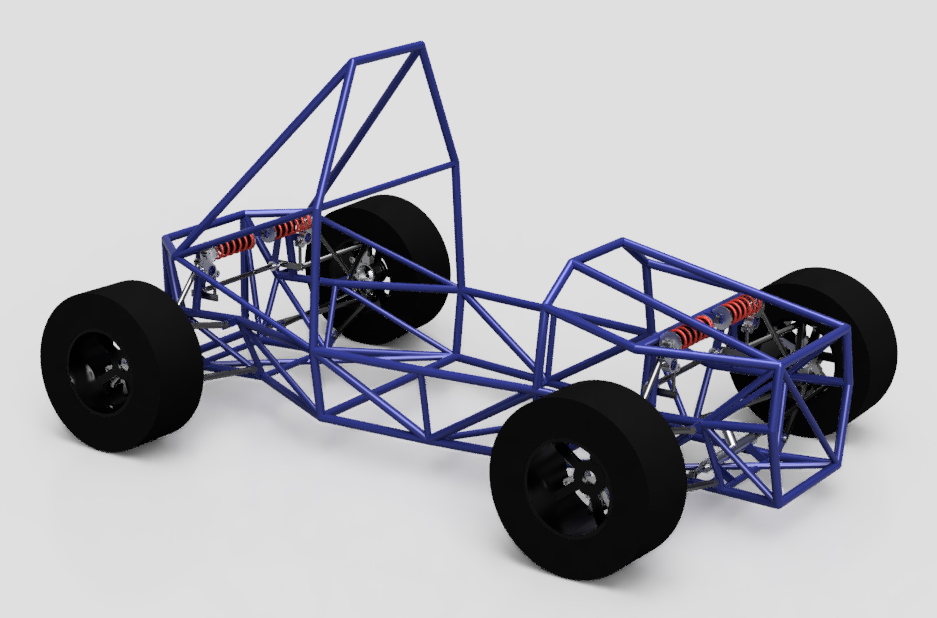
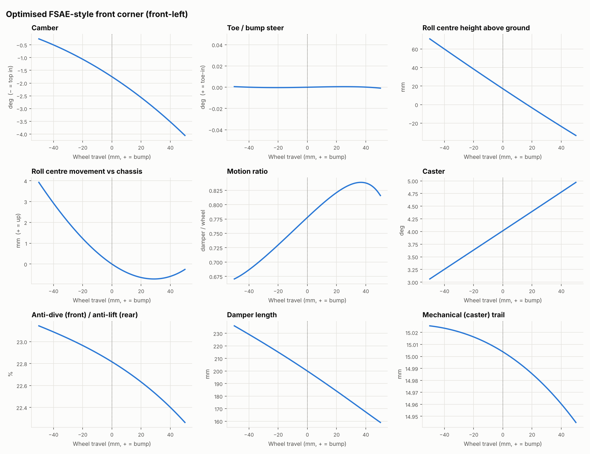
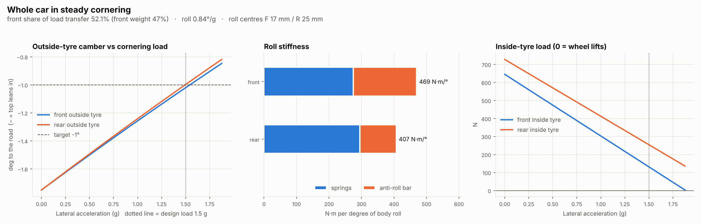
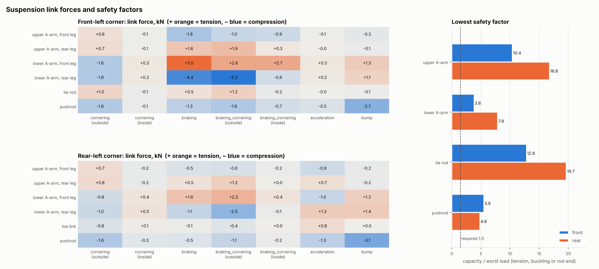
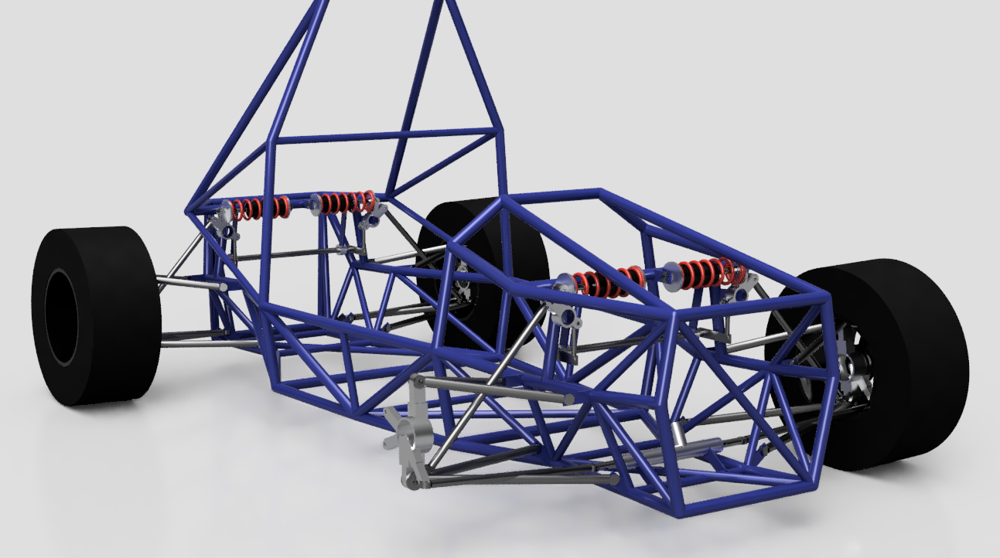
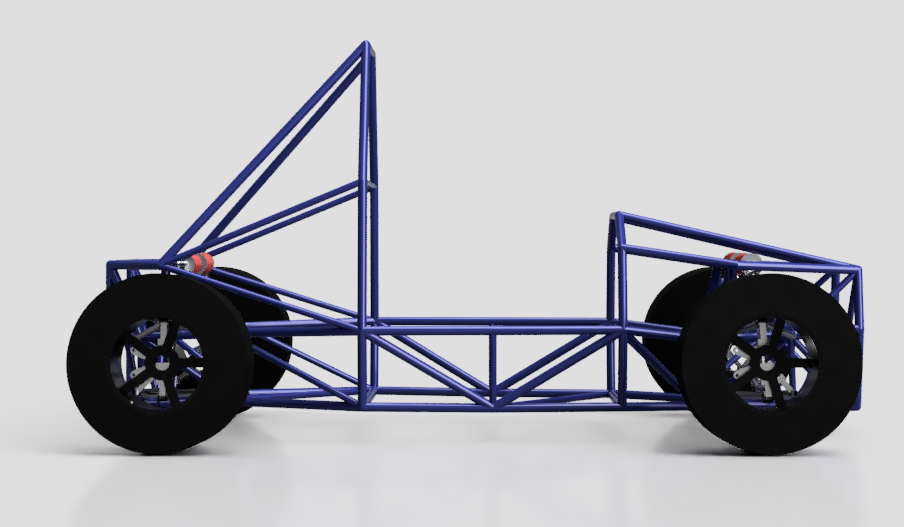
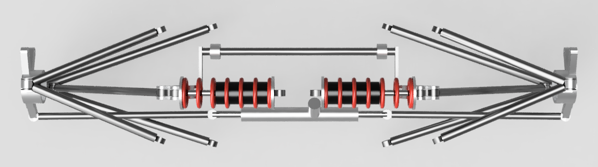

# Suspension design report

A complete front and rear double-wishbone suspension for a made-up Formula SAE style
car, from hardpoints to CAD. Every number here comes from the tools in this repo
and can be re-run. Every hardpoint and the full tables are in the
[full design notes](design-details.md).

## 1. The brief

There was no team or rulebook, so I set my own brief from typical FSAE numbers: a
280 kg car with driver (47% front), a 290 mm CG height, a 1550 mm wheelbase, and
10 inch wheels. The design load is 1.5 g of steady cornering.

The targets:

* **Outside tyre at -1° camber at 1.5 g**, where the tyre grips best.
* **A low roll centre that stays put on the chassis**, so roll behaviour doesn't
  change as the car rises and falls.
* **Near-zero bump steer**, so the car doesn't steer itself over bumps.
* **20 to 30% anti-dive and anti-squat**, to cut pitch without a harsh ride.
* **Positive Ackermann**, for tight FSAE corners.
* **Mild understeer:** the front takes a few points more of the load transfer than its
  weight share.
* **Every joint inside the 10 inch rim.**

## 2. Layout

* **Unequal-length double wishbones** give the best control of camber and roll
  centre.
* **Pushrods to rockers** put the dampers inside the frame, out of the airflow and
  the tyre's way. The rocker sets the motion ratio.
* **U-bar anti-roll bars** are driven from the rockers, so they change roll
  stiffness without changing ride.
* **Steering:** the rack sits in front of the axle with short, straight tie rods.
  At the rear, a toe link holds the toe.

## 3. Method

The `suspkin` Python package does all the maths, and the Fusion scripts only draw
what it writes out.

1. **Kinematics.** The solver treats the upright as a rigid body held by five
   fixed-length links and finds its position by least squares.
2. **Optimisation.** The optimiser moves chosen hardpoints to hit the targets. The
   rim is a hard limit.
3. **Whole car.** Both sides of each axle are solved as the body rolls, which gives
   roll stiffness, roll per g and the load transfer split.
4. **Loads.** For each load case, the upright's equilibrium gives the force in every
   link. The rocker's equilibrium then gives the damper and anti-roll bar loads.
5. **Parts.** The uprights and rockers are built from the hardpoints and checked
   three ways: hand calcs, a built-in FE model, and Ansys Student.

184 automated tests check the solver against things that must hold, such as
constant link lengths and virtual work balancing.

## 4. Geometry

| | Front | Rear |
|---|---|---|
| Static camber | -1.75° | -1.75° |
| Camber gain | -0.38° per 10 mm | -0.36° per 10 mm |
| Bump steer (±50 mm) | 0.001° | 0.002° |
| Roll centre height | 17 mm | 25 mm |
| Roll centre movement vs chassis | 0.04 mm per mm | 0.02 mm per mm |
| Caster / kingpin angle | 4.0° / 6.2° | 0° / 6.2° |
| Anti-dive / anti-squat | 23% anti-dive | 25% anti-squat |
| Ackermann | +17% at full lock | |
| Motion ratio | 0.78, mildly rising | 0.77, mildly rising |

**What shaped it.** The hand-drawn baseline had a roll centre that moved 0.38 mm for
every mm of bump. The optimiser cut that to 0.04 mm. A ball-joint spread goal stopped
it from squeezing the joints together, because that would have doubled the arm
loads. The lower front pivot was then tilted to add anti-dive, and the outer tie rod
moved outboard to turn negative Ackermann positive. Finally, the upper ball joint came
down 6 mm so a real bearing housing fits inside the rim. That cost a little camber
gain, so static camber went to -1.75°.

## 5. Springs, anti-roll bars and balance

The springs were picked for a ride frequency of about 2.85 Hz at both ends
(35 N/mm front, 40 N/mm rear). That's typical for a low-downforce FSAE car. With
springs alone, the front took only 39% of the load transfer, which leans toward
oversteer. The anti-roll bars brought it to 52%.

| | Value |
|---|---|
| Roll gradient | 0.84° per g |
| Front share of load transfer | 52% (front weight 47%) |
| Outside tyre camber at 1.5 g | -1.02° front, -1.00° rear (target -1°) |

The camber target is met almost exactly. The front inside tyre lifts at about 1.9 g.

## 6. Strength

There are seven load cases: cornering, braking, braking while cornering,
acceleration (all at 1 to 1.6 g) and a 3 g bump. The worst link force is 5.2 kN in
the front lower wishbone under braking.

| Part | Safety factor | Required |
|---|---|---|
| Weakest tube or rod end (front lower wishbone rod end) | 3.8 | 1.5 |
| Front upright (7075-T6, ~150 MPa in Ansys) | 3.4 | 2 |
| Rockers | 3.0 to 3.5 | 2 |
| Pushrod brackets | 4.4 to 5.6 | 2 |

The arms could be about half the weight and still pass. I kept the 3/4 in tube for
stiffness and damage tolerance.

The Ansys study had one key lesson. With a sharp inside corner on the upright, the
peak stress kept rising as the mesh was refined (157 to 320 MPa), because a sharp
corner has no true stress value. A real fillet brought it down to about 150 MPa.
The full study is in [phase9-ansys-results.md](phase9-ansys-results.md).

## 7. The whole car

The same numbers build the whole car in Fusion: four corners, dampers, anti-roll
bars, the steering rack, wheels, and an FSAE-style space frame (126 tubes, about
34 kg of 4130). Every wishbone pickup sits at a frame node. A clearance check runs
every frame tube against every suspension part, and none comes within 3 mm. The
frame is a packaging model; it hasn't been checked against the rules or for
strength.

| | |
|---|---|
|  |  |

## 8. Limitations and next steps

The models use rigid tyres and parts, check clearance at ride height only, and use
realistic but made-up inputs (mass, CG, rod end ratings).

What I'd change next:

1. **Brake bias forward**, from 65% toward the ideal 77% front at 1.6 g.
2. **Delay the front inside tyre lift** with a slightly softer front bar.
3. **Add a bump stop**, because the 3 g bump uses more than the damper's stroke.
4. **Lighten the uprights** (about 510 g now; 350 to 450 g is typical) with pockets.
5. **Add a tyre model** to turn camber and load transfer into grip and lap time.

To reproduce everything, see the [technical guide](technical-guide.md).
