# Technical guide

The full reference for the `suspkin` tools: every command, the conventions, how the
solver works, and what each phase of the project added and found. For the short
version, see the [README](../../README.md); for the finished design and why it is the
way it is, see the [design report](../design-report.md).

## Quick start

```bash
git clone https://github.com/EthanDiaz10/suspension-kinematics.git
cd suspension-kinematics
python -m venv .venv
# Windows:      .venv\Scripts\activate
# macOS/Linux:  source .venv/bin/activate
pip install -e ".[dev]"

suspkin sweep data/baseline_fsae_front.json   # writes CSV, JSON and plots to results/
suspkin steer data/baseline_fsae_front.json   # steering sweep and Ackermann
suspkin roll data/optimized_front.json        # body roll, anti-roll bar, roll per g
suspkin car data/optimized_front.json data/optimized_rear.json   # whole car, real front + rear
suspkin loads data/optimized_front.json data/optimized_rear.json # link forces, tube sizing
suspkin check data/baseline_fsae_front.json   # do the joints fit inside the rim?
suspkin optimize data/baseline_fsae_front.json data/optimize_front.json   # ~2 minutes
pytest                                         # run the tests
```

Output for the baseline (`suspkin sweep`, trimmed):

```
camber_gain_deg_per_10mm                -0.371
bump_steer_deg_per_10mm                 +0.001
caster_deg                              +3.542
kpi_deg                                 +5.440
scrub_radius_mm                        +23.095
mech_trail_mm                          +12.738
roll_center_height_mm                  +28.825
rc_migration_vs_chassis_mm_per_mm       -0.383
motion_ratio                            +0.767
motion_ratio_change_droop_to_bump       +0.189
damper_travel_mm                       +76.046
anti_dive_pct                           -1.726
rocker_rotation_deg                    +87.723
Rocker layout at ride height:
  pushrod_to_rocker_arm_deg                 89.9
  damper_to_rocker_arm_deg                 100.0
```

Or from Python / a notebook (see `notebooks/01_bump_sweep.ipynb`):

```python
import suspkin as sk
hp = sk.load_hardpoints("data/baseline_fsae_front.json")
hp.chassis["UAF"][2] += 10           # try a design change
metrics = sk.compute_metrics(sk.bump_sweep(hp, travel_mm=50))
sk.plot_sweep(metrics, "my_change.png")
```

## Repository layout

| Folder | What lives there |
|---|---|
| `solver/suspkin/` | The Python package: hardpoint loading, the solver, pushrod/rocker stage, metrics, side-view, steering and roll analysis, rim packaging check, optimiser, plots, CLI |
| `data/` | Hardpoint sets, optimiser settings and load cases (`load_cases.json`) as JSON. Copy the baseline to start a new design |
| `tests/` | `pytest` checks (link lengths preserved, sign conventions, rim clashes, optimiser) |
| `notebooks/` | Jupyter notebooks for exploring designs |
| `cad/fusion/` | Fusion script that builds the sketch, tubes and joints from solver output and exports STEP ([how to run it](../../cad/fusion/README.md)) |
| `docs/images/` | Plots used in this README |

The solver and the CAD script only talk through JSON files (hardpoints or
`*_poses.json`), so each can change without breaking the other.

## Conventions

* **Units:** millimetres and degrees.
* **Axes (SAE/ISO):** +X forward, +Y left, +Z up. Origin on the ground, on the
  car centreline, at the front axle line. We model the **front-left** corner
  (and the **rear-left** one, whose file has its origin at the rear axle line;
  see Phase 7).
* **Signs:** negative camber = top of tyre leans in; positive toe = toe-in;
  positive caster = upper ball joint behind lower; positive scrub = steering
  axis hits the ground inboard of the contact patch.

### Hardpoints

| Chassis (fixed) | | Upright (moves as one rigid body) | |
|---|---|---|---|
| `UAF` / `UAA` | upper arm front / aft pivot | `UBJ` | upper ball joint |
| `LAF` / `LAA` | lower arm front / aft pivot | `LBJ` | lower ball joint |
| `RTI` | tie rod inner (rack) | `RTO` | tie rod outer (steering arm) |
| `SHC` | damper chassis end | `WC` / `CP` | wheel centre / contact patch |

| Pushrod and rocker (`"rocker"` block) | |
|---|---|
| `PRO` | pushrod outer end, on a bracket on the lower A-arm |
| `PRI` | pushrod inner end, on the rocker |
| `RKP` | rocker pivot, on the chassis; `"axis"` gives the pivot direction |
| `SHR` | damper end on the rocker |

Files without a `"rocker"` block still work: they need an `SHU` point on the
upright and the damper is treated as bolted straight to it (the Phase 1
placeholder).

The baseline is a made-up but realistic FSAE-sized front corner, not a real car,
with −1° static camber. `data/optimized_front.json` is the same corner after
running the optimiser (see below).

### Rim packaging

The ball joints and tie rod end sit inside the wheel rim, so the rim limits
where they can go. Each hardpoints file has a `"packaging"` block describing a
10" rim. `suspkin check` reports, for each joint, how far it is from the rim
barrel (radial margin) and from the hub mounting face. Because the upright and
wheel move together, this only needs checking at the design position.

## How the solver works

The upright is a rigid body, so its pose is 6 numbers: a **rotation vector**
(3, avoids Euler-angle gimbal lock) and a **translation** (3). Six equations
pin them down:

1. to 5. each of the five links (4 wishbone legs and the tie rod) keeps its design length;
6. the wheel centre sits at the requested height (design + travel).

`scipy.optimize.least_squares` solves these at every step from −50 to +50 mm,
starting each step from the previous answer. The tests check that every link
length is preserved to within 0.000001 mm at every pose.

Then the pushrod and rocker are solved (see below), which doesn't feed back
into the upright.

**Current simplifications:** the contact patch moves rigidly with the upright
(no tyre deflection), the roll centre is for pure heave of a symmetric car,
and parts are rigid (no compliance in bushes or the rocker).

## Optimisation (Phase 2)

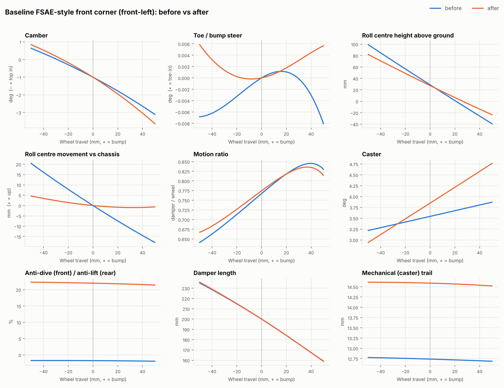

`suspkin optimize` moves chosen hardpoints to hit targets. Everything is set in
`data/optimize_front.json`:

* **Variables:** which points move, along which axis, and how far (mm). For
  example `"upper inner pivots z"` moves both upper-arm chassis pivots up or
  down together by up to 25 mm.
* **Goals:** each has a `target`, a `scale` (how far off counts as one unit
  of bad) and a `weight` (how much you care). The score is
  `sum(weight × ((achieved − target) / scale)²)` and lower is better.
* **Hard limits:** the variable bounds, and every joint must fit in the rim.

| Goal | Meaning | Target | Baseline | Optimised |
|---|---|---|---|---|
| `rc_migration` | roll-centre movement relative to the chassis, per mm of travel | 0 | −0.38 | −0.05 |
| `rc_height` | static roll-centre height (mm) | 30 | 28.8 | 28.0 |
| `camber_gain` | camber change per 10 mm of bump (deg) | −0.40 | −0.37 | −0.45 |
| `bump_steer` | toe change over ±50 mm (deg) | 0 | 0.009 | 0.019 |
| `bj_spread` | distance between the ball joints (mm), for joint and arm loads | 210 | 211 | 195 |
| `kpi` | kingpin inclination (deg) | 5.5 | 5.4 | 5.9 |

(These "optimised" numbers are the optimiser's own output. The file has since
had the Phase 4 anti-dive and Ackermann changes applied, which move RC height
to 27.5 mm and bump steer to 0.007°; see Phase 4 below.)

Two more goals are available but not switched on in the default config:
`motion_ratio` (static damper/wheel ratio) and `anti_dive` (%). Rocker points
(`PRO`, `PRI`, `RKP`, `SHR`, `SHC`) can be used as variables too.

**Why roll-centre movement is measured against the chassis.** The centre of
gravity rides on the chassis. If the roll centre stays put on the chassis, the
lever arm between them (which sets how much the car rolls) stays the same as
the car rises and falls. Measured from the ground instead, even a perfectly
fixed roll centre "drops" 1 mm per mm of bump, which is why the
"height above ground" plot still slopes after optimising.

**Things to know:**

* The optimiser (`scipy.optimize.minimize`, SLSQP) walks downhill from the
  starting geometry. It finds a good design nearby, not necessarily the best
  one possible. Different bounds or a different starting design can give a
  different answer.
* "Iteration limit reached" just means it used its full 100-iteration budget.
  The score had already dropped from 235 to about 10.
* Variables that finish **at a bound** are printed with a marker. The
  optimiser wanted to go further, so think about whether that bound is real
  (packaging, chassis tubes) or can be widened.
* It only knows about the goals you give it, and goals pull against each
  other. Without the `bj_spread` and `kpi` goals, the same run cut RC
  migration to −0.006 but squeezed the ball joints from 211 to 172 mm apart
  and raised KPI to 6.6°. With them it settles at −0.05 with the joints
  195 mm apart. The upper ball joint is already against the rim, so the
  lower one is the only joint that can move, and lowering it fights the RC
  goal. The weights decide where that balance lands.

## CAD model in Fusion (Phase 3)

`cad/fusion/SuspensionModel/` is a Fusion script. Point it at
`data/optimized_front.json` (or a `*_poses.json` sweep, at any wheel travel)
and it opens a new design with a master 3D sketch of every hardpoint and link,
tubes with ball joints and rod ends, a see-through reference tyre, and writes
a STEP file. Install and run steps are in [cad/fusion/README.md](../../cad/fusion/README.md).

## Pushrod, rocker, anti-dive and Ackermann (Phase 4)

### Pushrod and rocker

The front view at the top of this page shows the layout. The pushrod runs from a bracket on the lower A-arm (`PRO`) up to a rocker,
which turns about a fixed axis on the chassis and pushes the damper. It is
solved in two small steps after the upright (`solver/suspkin/rocker.py`):

1. The lower arm is a rigid body turning about its two chassis pivots, so its
   rotation angle comes from where the lower ball joint went. `PRO` turns by
   the same angle.
2. The rocker can only spin about its axis, so `PRI` moves on a circle, and
   the pushrod says `PRI` must sit on a sphere of fixed radius around `PRO`.
   A circle meets a sphere in at most two points, found exactly with a bit of
   trigonometry (`A cos θ + B sin θ = C`). The one nearest the previous step
   is the real one.

The damper length is then `|SHR − SHC|`, and the **motion ratio** is
damper travel / wheel travel. Wheel rate = spring rate × MR². Some books call
this the installation ratio, and some define the motion ratio the other way
up (wheel / damper), so check which one a reference means before comparing.
Set `"pushrod_mount"` to `"upper_arm"` for a pullrod, or `"upright"` to mount
it on the upright.

The baseline has MR 0.77 at ride height, rising from 0.64 in full droop to
0.83 in bump (progressive), and the damper moves 38 mm over ±25 mm of wheel
travel. `suspkin sweep` also prints a few layout checks: the pushrod should
meet its rocker arm near 90° (near 0° or 180° the rocker is close to
locking), and the pushrod and damper should sit in the rocker's plane.

### Side view: anti-dive and caster trail

As the wheel moves, the upright swings about the **side-view instant centre**.
Where that point sits decides how much of the braking weight transfer goes
through the arms instead of the springs, which is **anti-dive** (front) or
anti-lift / anti-squat (rear). The solver finds it from the actual 3D motion of
the wheel centre and contact patch, not a hand construction; a test checks it
against the textbook method of drawing lines through the ball joints parallel
to each arm's pivot axis.

The anti percentages need a few whole-car numbers, set in the `"vehicle"`
block of the hardpoints file: wheelbase, CG height, front brake bias, inboard
or outboard brakes, and whether the axle is driven. Mechanical trail (caster
trail) is in the sweep output too.

The baseline has about −2% anti-dive (very slightly pro-dive): its arm pivots
are nearly level in side view. Lowering the lower arm's front pivot 5 mm and
raising its rear pivot 5 mm gives about 19% (see *Applied to the optimised
design* below).

### Steering and Ackermann

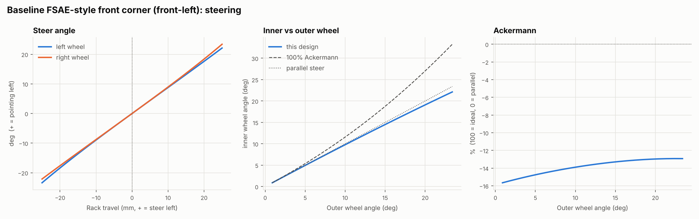

`suspkin steer` moves the rack from −25 to +25 mm and reports both wheels'
steer angles and the **Ackermann percentage** (100% = the inside wheel turns
exactly enough for both wheels to circle the same point at low speed, 0% =
both wheels turn the same, below 0 = the outside wheel turns more). Only the
left corner is modelled: the right wheel is its mirror image, so the right
wheel at rack +r is the mirrored left wheel at rack −r. A test builds a real
mirrored right corner and checks this gives identical angles.

The baseline is about −13% Ackermann (slightly anti-Ackermann) with 22° to
23° of lock at 25 mm of rack and a ~3.7 m turning radius. With the rack ahead
of the axle, moving the outer tie-rod end (`RTO`) outboard angles the steering
arm out and adds Ackermann: 20 mm further out takes it from −13% to about
+20%, at the cost of a little
more bump steer (0.2° over ±50 mm), so the rack height would need re-tuning
with it.

Race cars often run well under 100% Ackermann, because at speed the loaded
outside tyre works at a bigger slip angle. It's a tuning choice.

### Applied to the optimised design

`data/optimized_front.json` now carries both changes on top of the Phase 2
optimiser result (the baseline is left as it was, as the "before"):

| Change | Why |
|---|---|
| Lower-arm front pivot (`LAF`) 5 mm down, rear pivot (`LAA`) 5 mm up | anti-dive |
| Outer tie-rod end (`RTO`) 20 mm outboard | Ackermann |
| Rack (`RTI`) 0.6 mm outboard and 0.7 mm down | cancels the bump steer the `RTO` move added |

| | Before | After |
|---|---|---|
| Anti-dive | −0.6% | 22% |
| Ackermann at full lock | −16% | +17% |
| Toe change over ±50 mm (bump steer) | 0.019° | 0.007° |
| Camber gain per 10 mm | −0.445° | −0.442° |
| Roll-centre height | 28.0 mm | 27.5 mm |
| Roll-centre movement vs chassis | −0.051 | −0.055 |
| `RTO` clearance to the rim barrel / hub face | | 5.9 mm / 6.4 mm |

Caster, KPI, scrub, trail and motion ratio don't change. The rack position was
found with a quick two-variable search for the smallest toe change over the
sweep. The `RTO` move uses up most of the room left inside the rim, so it's
about as far as it can go there.

## Roll sweep (Phase 5)

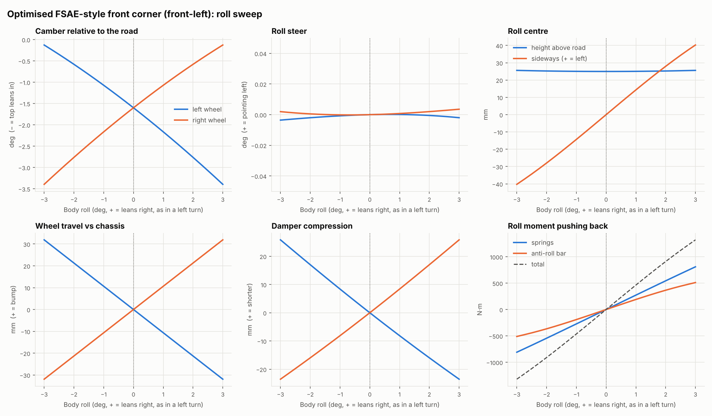

<p align="center">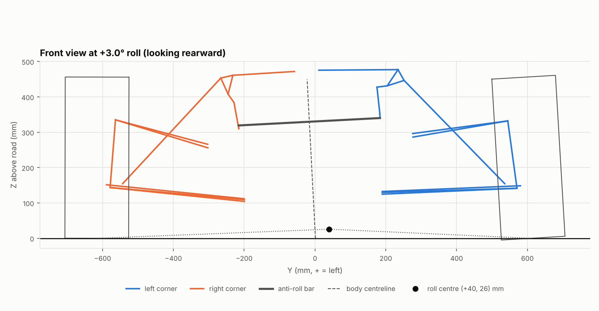</p>

`suspkin roll` leans the body from −3° to +3° and solves **both** front
corners at once (`solver/suspkin/roll.py`). As in the steering sweep, only the
left corner is modelled: the right wheel in bump is the left corner solved at
the same bump travel and mirrored, and a test checks this against a real
mirrored right corner.

How a roll angle is set up: the two wheels move equal and opposite amounts
relative to the chassis (left down, right up), which with equal springs keeps
the total spring force about the same, so the car rolls without heaving. The
road is the line through the two contact patches, and a 1D root finder picks
the wheel travel that tilts that line by exactly the requested angle.

Positive roll means the body leans right, as in a **left** turn (the same
"left is positive" rule as the steering sweep), so the right wheel is the
outside wheel. What it reports:

| Output | Meaning |
|---|---|
| Roll camber | camber change relative to the **road** per degree of roll. A wheel that simply leaned with the body would be +1°/° on the outside wheel. |
| Camber compensation | how much of that the camber gain in bump cancels: 0% = leans with the body, 100% = stays upright to the road |
| Roll steer | steer change per degree of roll; below 0 at the front = steers out of the turn = roll understeer |
| Roll centre | where the lines from each contact patch through its instant centre cross. With the car rolled it moves sideways as well as up and down |
| Wheel / damper travel per degree | from the solved poses; their ratio is the motion ratio |
| Roll stiffness | springs plus the anti-roll bar if there is one (rigid tyres), from the stored energy: `½k(x_L² + x_R²)` for the springs, so a rising-rate rocker is included. A test checks it against the textbook `k·MR²·track²/2` |
| Body heave | how much the body rises or sinks as it rolls (jacking) |

The spring rate comes from `"spring_rate_n_per_mm"` in the `"vehicle"` block
(35 N/mm, about 200 lb/in, is a made-up placeholder), or `--spring-rate` on
the command line.

These are the Phase 5 numbers, before the anti-roll bar and camber change below:

| ±3° roll | Baseline | Optimised |
|---|---|---|
| Roll camber, outside wheel | +0.61°/° | +0.53°/° |
| Camber compensation | 39% | 47% |
| Outside-wheel camber at 3° roll | +0.72° | +0.42° |
| Roll steer | 0.001°/° | 0.000°/° |
| Roll centre height (static → 3°) | 28.8 → 24.2 mm | 27.5 → 28.1 mm |
| Roll centre sideways movement | 86 mm/° | 14 mm/° |
| Wheel / damper travel | 10.6 / 8.2 mm/° | 10.6 / 8.2 mm/° |
| Roll stiffness (35 N/mm springs) | 268 N·m/° | 273 N·m/° |

The optimiser's roll-centre migration goal (Phase 2) pays off here: the
optimised roll centre barely moves sideways, so the roll moment arm stays the
same through a corner. Even so, the outside tyre went from −1° static camber
to about +0.4° at 3° of roll, which costs grip. Phase 6 fixes that.

## Anti-roll bar and roll per g (Phase 6)

<p align="center"></p>

### The bar

An anti-roll bar is a torsion bar running across the car. A drop link joins
each end of it to the suspension, here a tab on each rocker. In heave both
ends turn together and the bar does nothing; in roll they turn opposite ways,
the bar twists, and it pushes back. So it adds roll stiffness without making
the ride any harsher. It's an optional `"arb"` block in the hardpoints file
(`solver/suspkin/arb.py`):

| Point | What it is |
|---|---|
| `ARL` | drop link lower end, on the rocker (`"link_mount"` can also be `"lower_arm"`, `"upper_arm"` or `"upright"`) |
| `ARA` | drop link upper end = the end of the bar's arm |
| `ARP` | where the arm joins the bar; the bar runs along the Y axis through it |

plus `"rate_nm_per_deg"`, the bar's torsional rate. The arm angle is solved
with the same closed-form circle-meets-sphere maths as the rocker. Mirroring
the left corner gives the right arm's angle with no sign change, so the twist
is the left arm's angle in droop minus its angle in bump; a test checks that
against a real mirrored right corner. Bar roll stiffness = rate × (twist per
degree of roll)². On this layout the bar twists 5.5° per degree of body roll.

### How far the car rolls, and the front/rear balance

The roll sweep now also uses a few whole-car numbers from the `"vehicle"`
block: mass, weight split, CG height, and the rear's roll stiffness, roll
centre and track. The rear ones are placeholders until the rear corner is
designed. From those (Milliken, ch. 18):

* **Roll per g** = weight × (CG height − roll axis height) / (front + rear roll stiffness).
* **Front share of lateral load transfer** (often called TLLTD): how much of
  the weight moving to the outside tyres goes through the front axle. It's a
  main balance knob: more on the front means more understeer. A common start
  is a few percent above the front weight share.
* **Outside-tyre camber at the design load** (`"design_lateral_g"`, 1.5 g),
  and the **static camber** that would put it at `"target_outside_camber_deg"`.
  Static camber shifts the whole camber-in-roll curve up or down, so this is
  a direct read-off (a test checks it).

### Applied to the optimised design

| | Phase 5 | Phase 6 |
|---|---|---|
| Front anti-roll bar | none | 6.5 N·m/° |
| Front roll stiffness (springs + bar) | 273 N·m/° | 273 + 193 = 466 N·m/° |
| Roll per g | 1.03°/g | 0.81°/g |
| Front share of load transfer | 39% (oversteer-ish, below the 47% front weight) | 51% |
| Static camber | −1.0° | −1.6° |
| Outside-tyre camber at 1.5 g | −0.2° | −1.0° |
| Upper ball joint (`UBJ`) | | 2 mm lower |

The bar rate was picked for about 51% front load transfer, a mildly
understeering starting point. With the car then rolling 1.2° at 1.5 g, −1.6°
static camber leaves the outside tyre at the −1° target. The extra camber
tilts the rim toward the upper ball joint, so `UBJ` came down 2 mm to stay
inside it (1.4 mm clearance); that changes camber gain, KPI and anti-dive by
less than 0.1 and drops the roll centre from 27.5 to 25.0 mm.

The bar's moment curve flattens a little at bigger roll angles (the arm and
drop link geometry is slightly regressive). Making the drop link meet the arm
closer to 90° at full roll would straighten it.

Try other bar rates without editing the file:

```bash
suspkin roll data/optimized_front.json --arb-rate 0     # no bar
suspkin roll data/optimized_front.json --arb-rate 10    # stiffer bar
```

## Rear corner and the whole car (Phase 7)

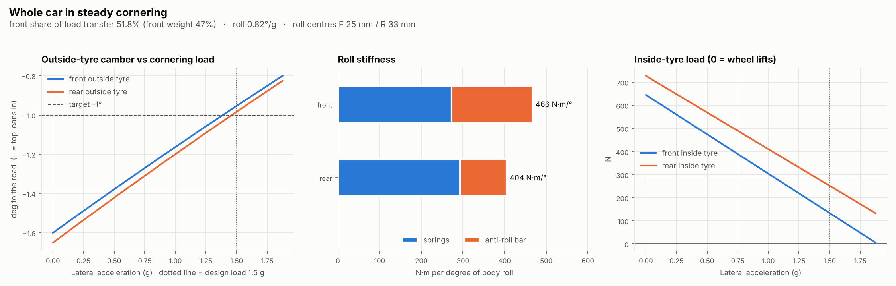

### The rear corner

`data/baseline_fsae_rear.json` and `data/optimized_rear.json` describe the
**rear-left** corner. It is the same double wishbone and the same solver, with
three differences:

* **A toe link instead of a tie rod.** It uses the same two points (`RTI` on
  the chassis, `RTO` on the upright), but nothing moves `RTI`, so it just holds
  the toe. `suspkin steer` refuses a rear file, and `suspkin sweep` reports
  the toe change in bump. The toe link sits **behind** the axle (x = −70 mm).
* **Its own origin.** The file's origin is on the ground at the **rear** axle
  line (so front and rear files read the same way). The Fusion script moves it
  one wheelbase back to its place on the car.
* **A driven axle** (`"axle": "rear"`, `"driven": true` in its `vehicle`
  block), with a chassis-mounted diff and outboard brakes. So the side view
  gives **anti-squat** (from the wheel centre's path, because the drive
  torque goes into the chassis) and **anti-lift** under braking (from the
  contact patch, with the rear's 35% of the braking).

The optimiser has a new goal, `anti_drive` (anti-squat at the rear), and on a
rear file the `anti_dive` goal means anti-lift. Side-view goals need
variables that tilt an arm in side view, so `data/optimize_rear.json` moves
the **front** pivot of each arm on its own (`UAF`, `LAF`) as well as both
pivots together. On this rear the solution has the arms almost parallel in
side view: the wheel moves about 0.5 mm rearward for every 10 mm of bump,
which gives both numbers below.

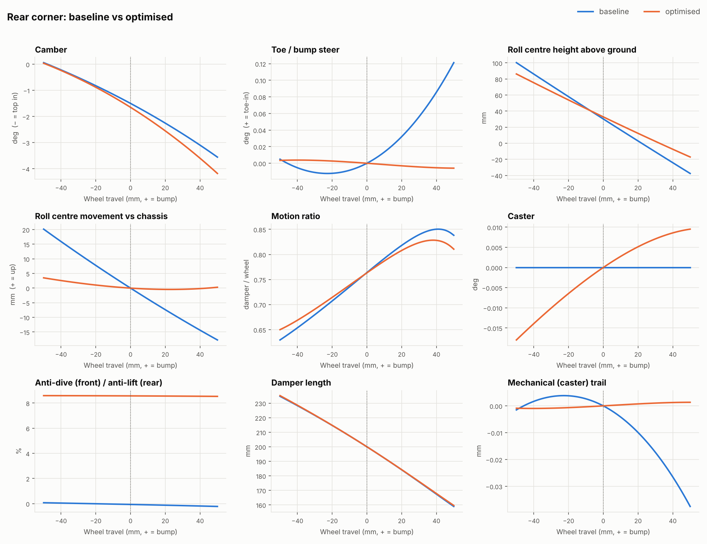

| Rear corner | Baseline | Optimised |
|---|---|---|
| Anti-squat | −0.4% | 25% |
| Anti-lift under braking | −0.1% | 9% |
| Toe change over ±50 mm | 0.13° | 0.01° |
| RC migration vs chassis | −0.38 mm/mm | −0.04 mm/mm |
| Roll centre height | 30 mm | 33 mm |
| Camber gain | −0.36°/10 mm | −0.42°/10 mm |
| Ball joint spread | 206 mm | 190 mm |

After the optimiser, by hand: the pushrod bracket moved up with the raised
lower arm, a 4.0 N·m/° rear bar (same layout as the front) was added, static
camber went to −1.65°, and `UBJ` came down 1.5 mm to stay inside the rim at
that camber. Rear springs are 40 N/mm (about 230 lb/in).

### The whole car: `suspkin car`

```bash
suspkin car data/optimized_front.json data/optimized_rear.json
```

runs a roll sweep on each axle and combines the **real** numbers for both
(`solver/suspkin/fullcar.py`): each axle's roll stiffness (springs and bar),
roll centre and track, then the roll axis, roll per g, and how the lateral
load transfer splits front/rear. Car-level numbers (mass, weight split, CG
height, design g) are read from the front file. It also reports, for each
axle, the outside tyre's camber at the design load, the static camber that
would hit the target, the inside and outside tyre loads (does the inside
wheel lift?), and each axle's ride frequency. Before Phase 7 the rear numbers
were placeholders in the front file's `vehicle` block; they're now copied
from the real rear so `suspkin roll` on the front file alone agrees, and
`suspkin car` warns if they drift apart.

| Whole car at 1.5 g | Phase 6 (placeholder rear) | Phase 7 (real rear) |
|---|---|---|
| Rear roll stiffness | 400 N·m/° (guess) | 293 springs + 112 bar = 404 N·m/° |
| Roll centres, front / rear | 25 / 45 mm (guess) | 25 / 33 mm |
| Roll per g | 0.81°/g | 0.82°/g |
| Front share of load transfer (front weight 47%) | 51% | 51.8% |
| Outside-tyre camber, front / rear | −1.0° / – | −0.95° / −0.98° |
| Inside-tyre load, front / rear | – | 134 / 252 N (static 645 / 728 N) |
| Ride frequency, front / rear | – | 2.85 / 2.82 Hz |

What it means: the car leans slightly toward understeer (about 5 points more
load transfer at the front than its weight share), it rolls about 1.2° at
1.5 g, and both outside tyres sit close to the −1° camber target. The roll
axis rises toward the rear, which is the usual layout. The front inside tyre
is the one to watch: it's down to about a fifth of its static load at 1.5 g
and would lift at about 1.9 g.

Try other rear bar rates by editing `"rate_nm_per_deg"` in the rear file's
`arb` block and re-running `suspkin car`: a stiffer rear bar moves load
transfer to the rear (less understeer) and reduces roll.

## Load cases, link forces and tube sizing (Phase 8)

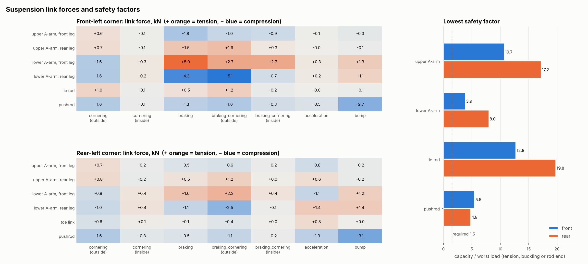

```bash
suspkin loads data/optimized_front.json data/optimized_rear.json
```

answers "will these tubes and rod ends survive?" (`solver/suspkin/loads.py`).
The cases, tube sizes, material and ratings are all in
[`data/load_cases.json`](../../data/load_cases.json), so you can change them without
touching code.

### 1. Load cases

| Case | What happens | Why that number |
|---|---|---|
| `cornering` | 1.6 g sideways | a little above the 1.5 g design load; the inside front tyre lifts at about 1.9 g |
| `braking` | 1.6 g braking | peak straight-line stop |
| `braking_cornering` | 1.1 g braking + 1.1 g sideways | trail braking, about 1.56 g combined |
| `acceleration` | 1.0 g forward | traction-limited launch, rear (driven) axle only |
| `bump` | 3 × the static corner load, straight up | pothole or kerb strike |

Every link must then hold **1.5 times** its worst case (`required_safety_factor`).

### 2. Tyre loads

Weight moves around the car: forward under braking (`m a h / L`), to the
outside in a corner (split front/rear by the real roll stiffness from
`suspkin car`, so it matches its tyre loads exactly). Every tyre is assumed to
use the same share of its grip, so its sideways and braking forces are just
`a × Fz`. A cornering tyre's sideways force acts 20 mm **behind** the contact
patch (the pneumatic trail, its self-aligning torque); without that the rear
toe link would carry nothing, because the rear has no caster. Drive force
acts at the wheel centre (the halfshaft takes the torque into the chassis-mounted
diff), braking at the contact patch (outboard brakes).

Only the left corners are modelled, so each cornering case is solved twice:
the left wheel on the **inside** of a left turn and on the **outside** of a
right turn (the mirror image of the right wheel in a left turn).

### 3. The force in every link

With a rod end or spherical bearing at each end, a wishbone leg, the tie rod
or the pushrod can only push or pull along its length (a **two-force
member**), so each link has one unknown. The upright must be in balance:
forces add to zero (3 equations) and moments add to zero (3 more).

The pushrod sits on the **lower arm**, not the upright, so the lower arm is a
rigid triangle held up by the pushrod. The solver takes the full 3D force at
the lower ball joint (3 unknowns) plus the pushrod force, and adds one
equation: the lower arm mustn't spin about its chassis pivots. That makes 7
equations and 7 unknowns, solved exactly. The lower arm's leg forces then
follow from the ball joint and pushrod forces (with the bracket treated as if
it sat on the ball joint; the small leftover, 2 to 6% of the biggest link
force, is reported as bracket bending).

Two tests check this from different directions: the link forces on the
upright cancel the tyre load exactly, and the pushrod force agrees with a
**virtual work** check that uses only the kinematic solver (move the wheel a
tiny bit: the work done by the tyre load and by the pushrod must add to zero).

### 4. Tubes and rod ends

Each link is a 4130 chromoly tube (yield 435 MPa, E 205 GPa), pinned at both
ends and as long as its joint centres:

* **Tension:** safety factor = yield stress × area / worst pull.
* **Compression:** a long, thin tube bows sideways and **buckles** well below
  yield. Euler's formula `P = π² E I / L²` covers slender tubes; short, stocky
  ones would come out stronger than the steel itself, so below the crossover
  slenderness the Johnson parabola is used instead.
* **Rod ends and ball joints:** worst force against the rated load.

### Results

| Member (front / rear) | Tube, mm | Worst load | Lowest safety factor |
|---|---|---|---|
| Upper A-arm | 19.05 × 1.65 | 1.9 kN pull (front, trail braking) | 10.7 / 17.2 (rod end) |
| Lower A-arm | 19.05 × 1.65 | 5.1 kN push, front rear leg, trail braking (outside) | 3.9 / 8.0 (rod end) |
| Tie rod / toe link | 15.875 × 1.65 | 1.2 kN pull (front, trail braking) | 12.8 / 19.8 (rod end) |
| Pushrod | 15.875 × 1.24 | 3.1 kN push (rear, bump) | 5.5 / 4.8 (rod end) |
| Lower ball joint | | 4.3 kN (front, trail braking) | 5.7 |

Everything passes with room to spare. The **front lower arm** works hardest:
under braking its front leg pulls and its rear leg pushes about 5 kN, because
it reacts the braking force and the brake torque. The **pushrods** are next,
in the 3 g bump. The rod ends set the lowest safety factors, and their ratings
in `load_cases.json` are **placeholders**: put in the static radial rating of
the parts you'd actually buy.

The lightest catalogue tube that still passes yield and buckling would be
12.7 × 0.89 for the upper arms and tie rods, 15.875 × 0.89 for the lower arms
(SF 2.4) and 12.7 × 0.89 for the pushrods (SF 2.4). Real arms usually stay a
size or two above that for stiffness (bending under the pushrod bracket, which
this static check doesn't size), crash damage and easier welding, so treat it
as the floor, not the answer.

The run also prints a note on **brake bias**: to lock all four tyres together
at 1.6 g the front needs about 77% of the braking, and the vehicle block has
65%. At 65% the rears lock first in a hard stop, which makes the car unstable.

### Files it writes (in `results/`)

| File | What's in it |
|---|---|
| `*_link_forces.csv` | tyre forces and every link force, per case and corner |
| `*_margins.csv` | worst pull and push, and the three safety factors, per link |
| `*_upright_loads.json` | the force on each upright joint (UBJ, LBJ, RTO) per case |
| `*_loads.png` | the plot above |

**Stress check in Fusion:** in a Static Stress study on your upright, put a
**fixed** constraint on the wheel-bearing bore and apply the forces from
`*_upright_loads.json` as loads on the ball joint and steering-arm holes, one
load case at a time (start with `braking_cornering (outside)` on the front,
the worst for the lower ball joint). The bore's reaction is then the tyre
load, so the joint forces and the tyre load are consistent.

**Simplifications:** loads are applied at ride-height geometry, the tyres' own
overturning and rolling-resistance moments are ignored, and parts are rigid.
Since Phase 9 the rocker, damper and anti-roll bar forces are computed too
(next section).

## Uprights, rockers and stress analysis (Phase 9)

Phase 8 sized the tubes. Phase 9 designs the **chunky parts** that hold them:
the **upright**, the **rocker** and the **pushrod bracket**, then checks
their stress three ways: hand calculations, a quick built-in finite element
(FE) analysis, and a final study in Ansys Student, which you run yourself.
The step-by-step for Fusion and Ansys is in
[`docs/phase9-fea-guide.md`](phase9-fea-guide.md), and the Ansys results
for the front upright are in
[`docs/phase9-ansys-results.md`](phase9-ansys-results.md): about
**150 MPa, safety factor 3.4** in the worst case, within 10% of the hand
calc, after three rounds of finding and filleting sharp corners.

```bash
suspkin loads data/optimized_front.json data/optimized_rear.json      # now with rocker loads
suspkin parts data/optimized_front.json data/optimized_rear.json      # geometry + hand calcs
suspkin parts data/optimized_front.json data/optimized_rear.json --step --fea --converge
```

`--step` and `--fea` need the optional extras: `pip install -e ".[fea]"`
(gmsh, scikit-fem, pyamg).

### 1. Rocker, damper and anti-roll bar loads

The pushrod carries the spring *and* the anti-roll bar, because the bar's drop
link hangs off the same rocker. The rocker can only spin about its pivot, so
it gives one equation for two unknowns (the damper force and the drop link
force). The split comes from how the car moves. In **heave** (braking, a
bump) the bar doesn't twist, so the spring takes everything. In **roll**,
spring and bar deflect together and share the load in proportion to their
roll stiffness (front: the bar is 41% of it, rear: 28%). Each cornering case
is split into a heave part and a roll part using its inside and outside wheel.
The pivot then carries what's left, shared between its two bearings.

| Front rocker | Pushrod | Damper | ARB link | Pivot |
|---|---|---|---|---|
| Ride height | 0.90 kN | 0.83 kN | 0 | 0.70 kN |
| Cornering 1.6 g (outside) | 1.56 kN | 1.17 kN | 0.58 kN | 1.73 kN |
| 3 g bump | 2.71 kN | 2.50 kN | 0 | 2.09 kN |

(All in compression. The rear is similar, with a 3.1 kN pushrod in the bump.)

Two independent checks are in the tests. A **virtual work** check: for a
tiny bump, the work done by the tyre load equals the work done on the damper,
with the motion taken from the kinematic solver. And a **bar torque** check:
the drop link force times the bar's arm (47 N·m at 1.6 g) equals the bar's
rate times its twist from the roll model, within 2%.

One thing this shows: in the 3 g bump the damper is pushed 48 mm past ride
height on the spring alone, more than the damper's stroke on the bump side.
So a **bump stop** has to catch that case, and its stiffness decides the
peak load. Worth choosing when you pick the damper.

### 2. Rim clearance and a hardpoint change

The first upright didn't fit: the upper ball joint's centre was 9 mm from the
rim, and a real spherical bearing housing needs about 13 mm. So both upper
ball joints moved **6 mm down**. Static camber went to **-1.75°** to keep the
outside tyre at -1° at 1.5 g, and the inner tie rod / toe link end moved about
1 mm to cancel the extra bump steer it caused (back to 0.001° over ±50 mm).
The cost: camber gain is 10% lower (-0.38°/10 mm), and the roll centres are
about 7 mm lower (front 17 mm, rear 25 mm), which adds a little roll (0.84°/g,
was 0.82). The upright now clears the rim by 1.5 mm.

### 3. The parts

Each part is built straight from the hardpoints out of simple cylinders and
boxes (`solver/suspkin/parts.py`), with sizes in
[`data/parts.json`](../../data/parts.json). Change a hardpoint or a size and every
part follows. The same description feeds the Fusion script
(`cad/fusion/SuspensionParts`), the STEP export and the built-in FE.

| Part | Material | What it is |
|---|---|---|
| Upright | 7075-T6 | Housing for two 61908 thin-section bearings, pressed-in spherical bearings at the ball joints (axis fore-aft, so nothing sticks out toward the rim), steering / toe-link arm, axial-mount caliper lugs behind the axle |
| Rocker | 7075-T6 | Two 6 mm plates (double shear) on a pivot tube with two 6201 bearings |
| Pushrod bracket | 4130 | Two 3 mm tabs welded to the lower wishbone |

**How the upright is held in a stress study.** The bearing bore is fixed and
the joint forces go into the ball joint and steering arm holes. One catch: a
wheel bearing can't carry torque about the axle, so under braking the brake
torque goes through the **caliper lugs**. `suspkin parts` works out the lug
forces (bolt-group method), and a test checks that their moment about the axle
equals the tyre's.

### 4. Results: three methods side by side

Worst load case per part. "Quick FE" is `suspkin parts --fea` (quadratic tets,
3 mm elements, arm-to-housing corners filleted); "converged" means a finer
mesh (2.1 mm) changed the peak by less than 5%. The pass mark is a safety
factor of 2 on yield (7075-T6: 503 MPa, 4130: 435 MPa).

| Part (mass) | Worst case | Hand calc, worst arm root | Quick FE peak | Safety factor | Mesh convergence |
|---|---|---|---|---|---|
| Front upright (508 g) | Braking while cornering (outside) | 136 MPa (steering arm) | 180 to 213 MPa | 2.4 to 2.8 | Not settled in the quick FE (a sharp corner). **Ansys, filleted: about 150 MPa, SF 3.4** (see below) |
| Rear upright (517 g) | Acceleration | 89 MPa (toe link arm) | 95 MPa | 5.3 | Converged (0%) |
| Front rocker (106 g) | 3 g bump | 106 MPa (damper arm) | 145 MPa | 3.5 | Converged (0.5%) |
| Rear rocker (106 g) | 3 g bump | 122 MPa (damper arm) | 167 MPa | 3.0 | Converged (0.5%) |
| Front pushrod bracket (25 g, 4130) | 3 g bump | 94 MPa (tab at weld) | 77 MPa | 5.6 | Converged (4%) |
| Rear pushrod bracket (25 g, 4130) | 3 g bump | 124 MPa (tab at weld) | 99 MPa | 4.4 | Converged (3%) |

Every part passes. The FE peaks run 1.1 to 1.6 times the hand calcs on the
aluminium parts, which is the stress concentration at the arm roots and
holes that a beam formula can't see. On the brackets the FE comes out lower,
because the hand calc puts all of the bending in the thinnest direction.

The front upright is the part to watch, as expected: it takes the biggest
loads (4.4 kN at the lower ball joint while braking and cornering), and it
deflects 0.4 mm at the lower ball joint. The rear moves 0.2 mm, the rockers
under 0.1 mm. The first version of the upright failed the quick FE (1,300 MPa
at a thin lower ball joint boss), and fixing that is what grew the boss to
36 mm and added the wider arm roots. Two cheap next steps: pocket the
upright's arms (it's heavy at about 510 g; 350 to 450 g is typical), and
check the steering arm's stiffness, since its 0.4 mm movement turns into
toe change.

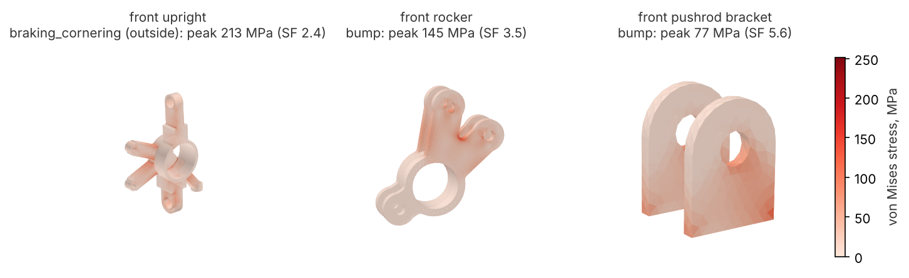

### 5. Ansys Student: the final check of the front upright

The front upright was re-checked in Ansys Mechanical (Student) with the same
supports and loads: the bearing bore held fixed, and a Remote Force on each
joint hole, including the caliper bolts that carry the brake torque.

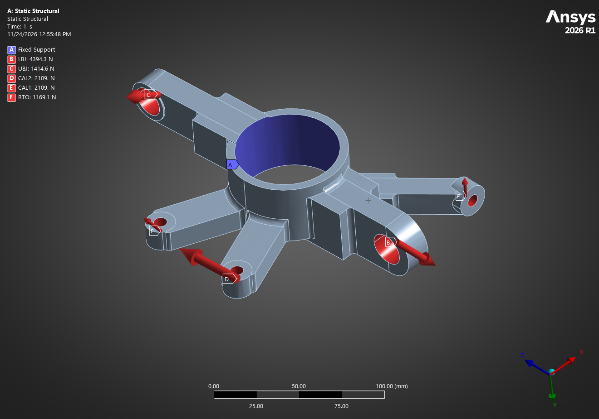

| Method | Peak stress | Safety factor |
|---|---|---|
| Hand calc (steering arm root) | 136 MPa | 3.7 |
| Quick FE (sharp corners) | 212 MPa | 2.4 |
| **Ansys, filleted** | **~150 MPa** | **3.4** |

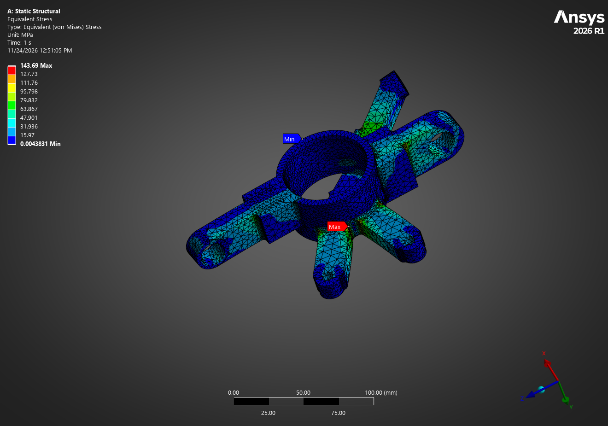

The interesting part was the mesh convergence. With the corner between the
steering arm and the lower ball joint arm left sharp, refining the mesh
there sent the peak from 157 to 237 to 320 MPa, and it would have kept
going: a sharp inside corner is a *singularity*, so its stress has no
converged value. Filleting it in Fusion brought the peak down to about
145 MPa. The last unfilleted modelling edge still climbs under adaptive
refinement while the deformation stays at 0.34 mm from 56k to 905k nodes,
so the design stress is read from the fillets and probes next to that edge.

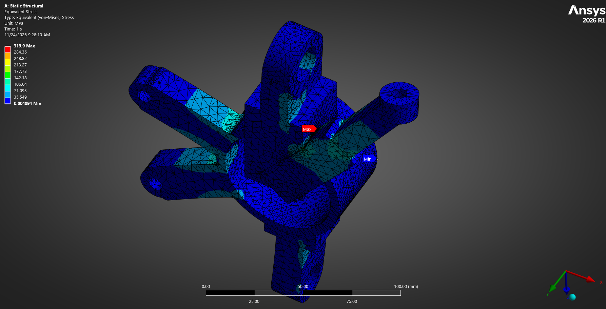

The full write-up, with the convergence tables, probe readings and lessons
learned, is in [`docs/phase9-ansys-results.md`](phase9-ansys-results.md).

### Files it writes (in `results/`)

| File | What's in it |
|---|---|
| `*_parts.json` | Part shapes and loads, for the Fusion script |
| `*_upright.step`, `*_rocker.step`, `*_pushrod_bracket.step` | One STEP per part (with `--step`) |
| `parts_fea_loads.csv` | Every force to type into Ansys: part, case, hole, hole centre, Fx, Fy, Fz |
| `parts_hand_calcs.csv` | Every hand calc, with the formula's inputs |
| `parts_fea.csv` | The quick FE results and mesh convergence (with `--fea`) |
| `*_rocker_loads.csv` | Damper, drop link, pivot and bearing loads (from `suspkin loads`) |

## The whole car in Fusion (Phase 10)

<p align="center">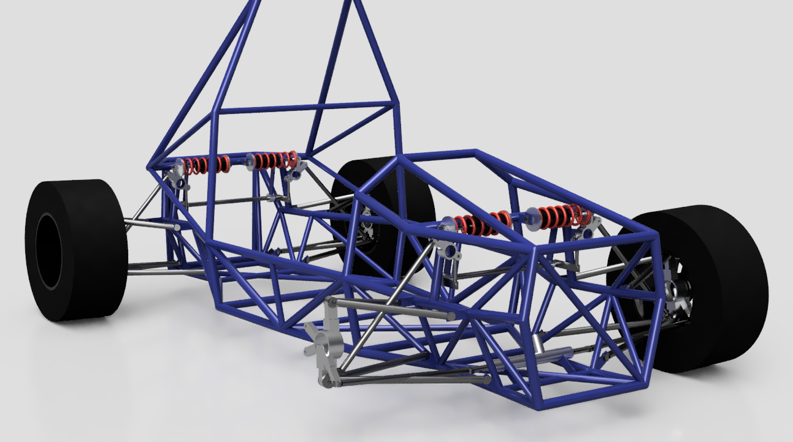</p>

`suspkin assembly` puts every part of the car into one file, and the Fusion
script `cad/fusion/CarAssembly` builds it in one go:

* **All four corners:** A-arms with rod ends and clevises, tie rods and toe
  links, pushrods, the Phase 9 uprights, rockers and pushrod brackets,
  dampers with springs, anti-roll bar drop links, 10 inch wheels and tyres.
  The right side is the left side mirrored and the rear corners sit one
  wheelbase back, exactly as the solver sees them.
* **Both anti-roll bars** and the **steering rack**.
* **An FSAE-style space frame** (126 tubes, about 40 m and 34 kg of 4130):
  front bulkhead, front and main hoops with braces, side impact tubes, and a
  front and rear suspension box. Every wishbone pickup sits on a short tab
  next to a frame node, so the arm loads go into the tubes along their length
  instead of bending one. The rockers and dampers hang off a cross tube with a
  strut down to the upper rail; tabs carry the rocker pivots, damper ends,
  anti-roll bar bearings, rear toe links and the rack.

```powershell
suspkin assembly data\optimized_front.json data\optimized_rear.json   # writes results\car_assembly.json
```

The command also runs a **clearance check**: it reports any frame tube that
comes within 3 mm of a suspension part (tubes, rod ends, damper, spring,
rack, anti-roll bar), treating each as round. For the current design nothing
does; the closest are the spring perches, about 5 mm from the rocker cross
tubes. That's at ride height only; checking full bump and droop is on the
roadmap.

Then run **CarAssembly** in Fusion (install it like the other scripts: see
[`cad/fusion/README.md`](../../cad/fusion/README.md)). It finds
`results\car_assembly.json` by itself, builds the bodies in nested
components (one per corner and part, plus the frame), sets materials and
appearances for rendering, and saves `results\car_assembly.step`.

Sizes of the stand-in parts (tube sizes, rod ends, damper, wheels) and the
frame's layout (hoop positions and heights, tube sizes, tab offsets) are in
`data/assembly.json`. The frame is a packaging and visual model, not a
rules-checked or stress-checked chassis. The picture above is a Fusion render of the
result (more in the [design report](../design-report.md)).

## Working on more than one PC

Git keeps every PC in sync through GitHub. Set up each PC once:

```bash
git clone https://github.com/EthanDiaz10/suspension-kinematics.git
cd suspension-kinematics
python -m venv .venv && pip install -e ".[dev]"   # activate .venv first, as above
```

Then every session follows the same routine:

```bash
git pull                      # 1. START: get what you did on the other PC
# ... edit, run, test ...
git add -A
git commit -m "Raise upper arm pivots 10 mm"
git push                      # 2. FINISH: send it up for the other PC
```

Tips:

* Always `git pull` before you start and `git push` before you walk away. That
  alone avoids almost all conflicts.
* `.venv/` and `results/` are not synced on purpose (see `.gitignore`). Each PC
  builds its own environment, and results can be regenerated in seconds.
* If `git pull` says there is a conflict, open the file, keep the lines you
  want, delete the `<<<<<<<`, `=======` and `>>>>>>>` markers, then
  `git add` the file and `git commit`.
* For a risky experiment, use a branch: `git switch -c try-longer-upper-arm`.
  Merge it back if you like it, delete it if not.

## Roadmap

- [x] **Phase 1:** repo scaffold, baseline hardpoints, bump sweep, camber/toe and other metrics, tests
- [x] **Phase 2:** optimisation, nudging chosen hardpoints to hit targets (camber gain, bump steer, roll centre height and migration) within 10" rim packaging limits
- [x] **Phase 3:** Fusion script: master 3D sketch, tube solids with ball joints and rod ends, STEP export, from hardpoints or `*_poses.json`
- [ ] Optimiser goal for scrub radius and mechanical trail
- [x] **Phase 4:** pushrod and rocker stage (motion ratio, rocker layout checks), side-view instant centre with anti-dive / anti-squat, steering sweep with Ackermann, rocker and damper in the Fusion script
- [ ] Optimiser goals for Ackermann (needs a steering sweep inside the loop)
- [x] **Phase 5:** roll sweep: both corners at once, roll camber and steer, roll centre under roll, roll stiffness from the springs
- [x] **Phase 6:** front anti-roll bar, roll per g, front/rear load transfer split, static camber chosen for the design cornering load
- [x] Draw the anti-roll bar in the Fusion script (Phase 10, `CarAssembly`)
- [x] **Phase 7:** rear corner (toe link, anti-squat and anti-lift, rear anti-roll bar), `suspkin car` for the whole-car roll stiffness split, load transfer, roll per g and tyre loads, rear corner in the Fusion script
- [x] **Phase 8:** load cases, tyre loads, the force in every link, tube (yield, Euler/Johnson buckling) and rod end checks, lightest passing tube, upright loads exported for a Fusion stress check
- [x] **Phase 9:** rocker, damper and anti-roll bar forces; upright, rocker and pushrod bracket designed around the hardpoints; hand calcs, STEP export, built-in FE check with mesh convergence; Fusion parts script; Ansys Student guide
- [ ] Joint loads at full bump instead of ride height
- [ ] Topology optimisation / pocketing of the upright to save weight
- [ ] **Phase 10:** full-car Fusion assembly (done: `suspkin assembly` + `CarAssembly`, FSAE-style space frame, clearance check, [design report](../design-report.md), renders)
- [ ] Frame clearance check at full bump, droop and steering lock

## License

MIT, see [LICENSE](../../LICENSE).
