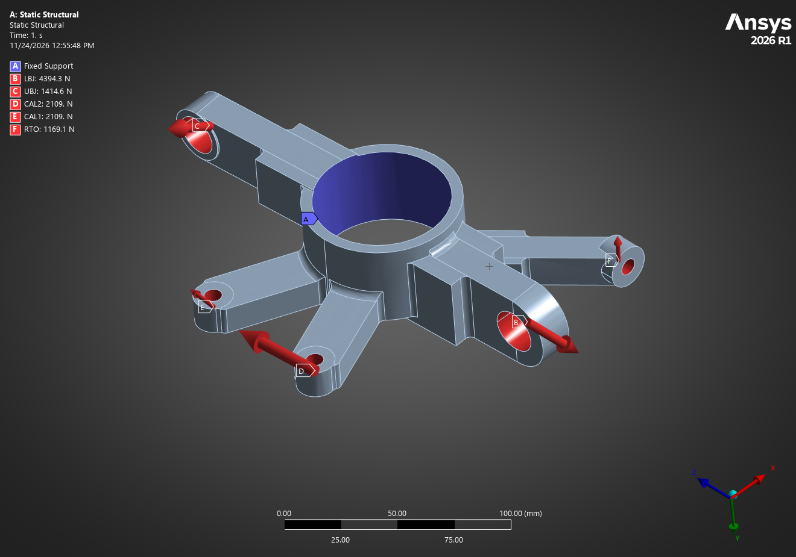
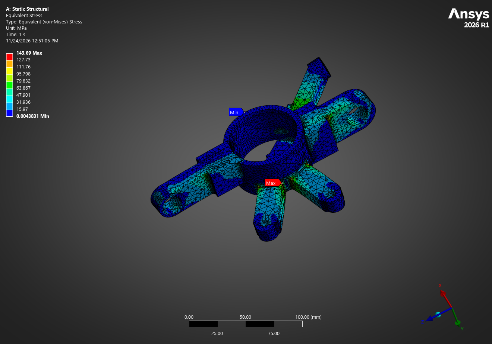
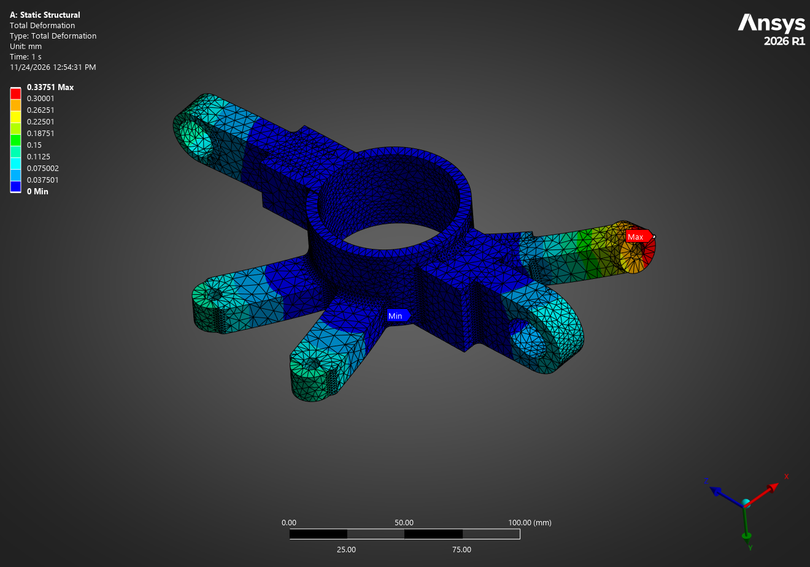
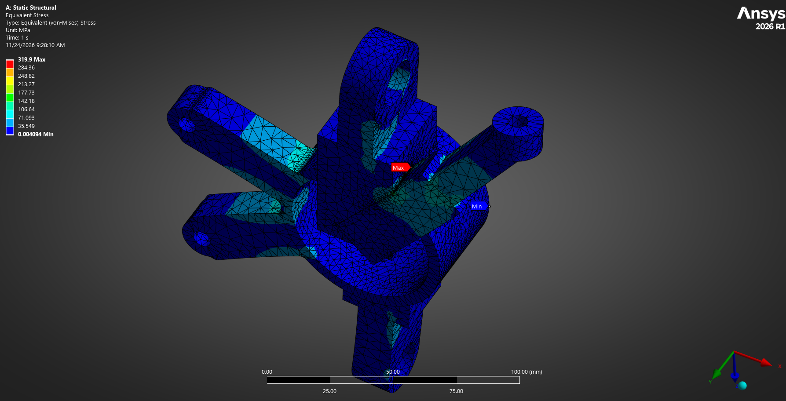
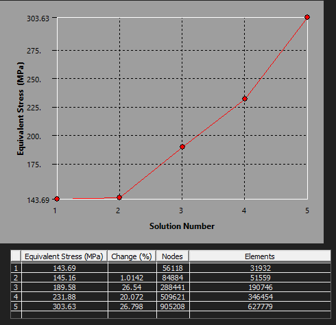
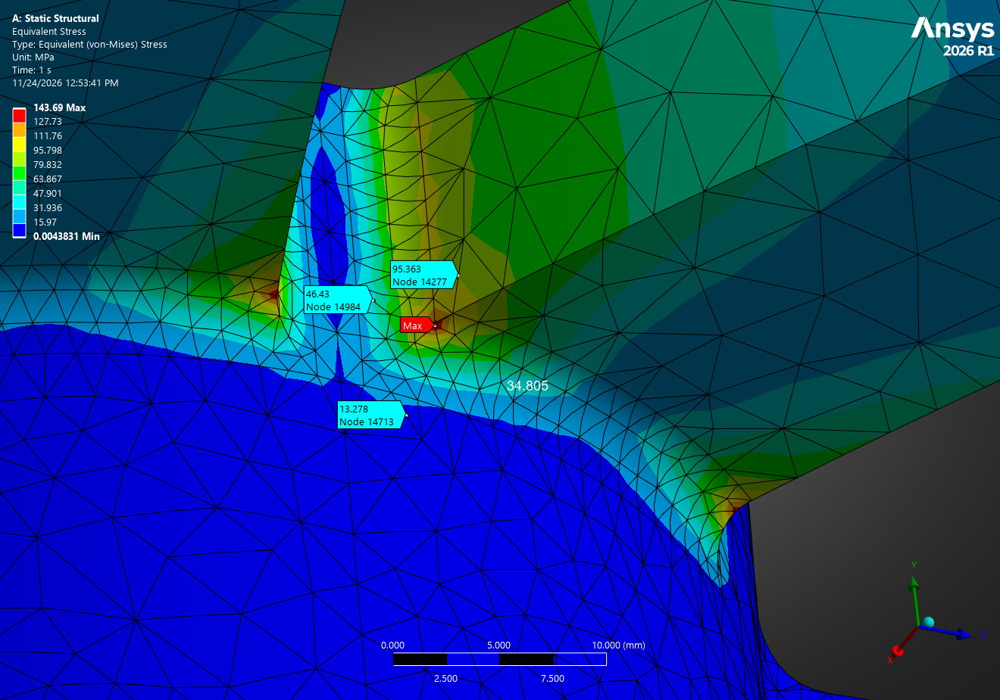
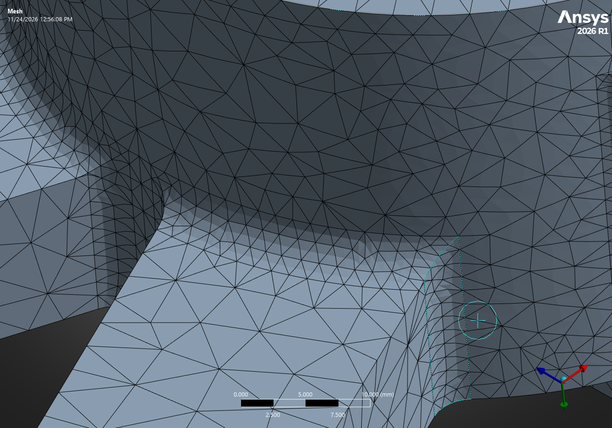

# Phase 9 results: front upright in Ansys Student

The final stress check of the most heavily loaded part, the **front upright**,
run in Ansys Mechanical (Student, 2026 R1) by following
[`phase9-fea-guide.md`](phase9-fea-guide.md). It is compared against the two
checks that `suspkin parts` runs on its own: the hand calculations and the
built-in quick finite element (FE) analysis.

**Result: the upright passes.** The design stress is about **150 MPa** against
the 503 MPa yield of 7075-T6, a safety factor of **3.4** (target: 2). The
one higher number in the model, at an unfilleted modelling edge, is a
singularity and not a real stress (section 4).

## 1. Setup

| | |
|---|---|
| Part | Front upright, `optimized_front_upright.step` with fillets added in Fusion (3 to 4 mm at the arm roots, the bosses and the V between the steering arm and the LBJ arm) |
| Mass | 509 g (Fusion, 7075-T6) |
| Material | 7075-T6: E 71.7 GPa, Poisson 0.33, yield 503 MPa, ultimate 572 MPa |
| Load case | `braking_cornering (outside)`, the worst case for this part in both the hand calcs and the quick FE |
| Support | Fixed Support on the bearing bore |
| Loads | Five Remote Forces (Deformable) on the hole faces, from `parts_fea_loads.csv` |
| Mesh | Quadratic tetrahedra, 3 mm body, 1.5 mm on the fillet faces; adaptive refinement for the convergence study |

| Hole | Centre x, y, z (mm) | Force x, y, z (N) | Total (N) |
|---|---|---|---|
| UBJ | -8.0, 555.0, 327.8 | -1153, -793, -204 | 1415 |
| LBJ | 5.0, 575.0, 142.5 | 2598, 3395, -1018 | 4394 |
| RTO (steering arm) | 68.0, 585.0, 150.0 | -9, -1166, -83 | 1169 |
| CAL1 | -75.5, 578.0, 259.0 | 164, -64, 2102 | 2109 |
| CAL2 | -75.5, 580.0, 195.1 | -164, -64, 2102 | 2109 |

The joint forces balance the tyre load exactly, so the bore reaction is the
tyre load. The two caliper bolts carry the brake torque, because the wheel
bearing can't.

## 2. Results

| Method | Peak stress | Where | Safety factor |
|---|---|---|---|
| Hand calc (beam formula, arm root) | 136 MPa | steering arm at the housing | 3.7 |
| Quick FE (`suspkin parts --fea`, 3 mm mesh, auto fillets) | 212 MPa | V between the steering arm and LBJ arm (left sharp) | 2.4 |
| **Ansys, filleted** | **~150 MPa** | fillets at the steering arm / LBJ arm junction | **3.4** |

| Deformation | Max movement |
|---|---|
| Quick FE | 0.370 mm |
| Ansys, sharp V | 0.368 mm |
| Ansys, filleted | 0.338 to 0.340 mm |

The two finite element models agree on stiffness to within 1% before the
fillets were added, which is a good check that the loads, supports and
material are the same in both. The fillets add a little material, so the
filleted part moves slightly less. The largest movement is at the steering arm
end, where the tie rod pulls sideways on a long, slim arm. 0.34 mm there is
about 0.03 deg of steer, which is negligible.

The Ansys peak sits within about 10% of the hand calc, which is what a
filleted corner should give (a stress concentration factor around 1.1). The
quick FE reads higher because its corners there were left sharp.

## 3. Mesh convergence: why the fillets mattered

**First run: the V corner left sharp.** The peak sat in the inside corner
where the steering arm's root block meets the LBJ arm's. Refining the mesh on
just that edge:

| Edge element size | Nodes | Peak (MPa) |
|---|---|---|
| none (3 mm body) | 46,866 | 158.5 |
| 1 mm | 47,574 | 156.9 |
| 0.5 mm | 49,475 | 236.9 |
| 0.25 mm | 51,513 | 319.9 |

The peak doubles and keeps climbing: a sharp inside corner has, in theory,
infinite stress, so the finer the mesh, the higher the number. That's a
**singularity**, not a result.

**Second run: V filleted (3 mm).** The peak dropped to 144 MPa and moved to
the step where the slim steering arm enters its wider root block, another
sharp corner. Ansys' adaptive refinement made it climb again (144, 156,
191 MPa), so that step got a 3 mm fillet too.

**Third run: step filleted.** Adaptive refinement on the peak:

| Loop | Nodes | Peak (MPa) | Change |
|---|---|---|---|
| 1 | 56,118 | 143.7 | |
| 2 | 84,884 | 145.2 | 1.0% |
| 3 | 288,441 | 189.6 | 26.5% |
| 4 | 509,621 | 231.9 | 20.1% |
| 5 | 905,208 | 303.6 | 26.8% |

The first two loops look converged, but the third shows the peak has found
one last sharp edge: the vertical line where the two root blocks meet, just
below the V fillet. Meanwhile the **maximum deformation stayed at 0.338 to
0.340 mm** from 56k to 905k nodes. The part as a whole is fully converged;
only the stress at that one edge isn't, exactly as theory predicts for a
singularity.

## 4. The design stress

That last edge is an artefact of building the part from overlapping blocks;
the machined part gets a 3 mm fillet there. So rather than chase it, the
stress was read just next to it with probes:

* on the 905k-node mesh: **98 MPa** 1.5 mm from the edge on the loaded block, **10 MPa** on the neighbouring block
* on the 56k-node mesh (picture below, peak 143.7 MPa): **95 MPa** about 1 mm from the peak, **46 MPa** and **13 MPa** further out
* the highest stress on any rounded surface (the fillets): about **135 to 150 MPa**

So the 304 MPa is confined to a sliver right on the edge. The design value is
taken as **150 MPa (SF 3.4)**: the top of the fillet range, matching the
144 to 145 MPa of the first two converged-looking loops and the 136 MPa hand
calc.

## 5. Lessons learned

* **Fillet every inside corner before trusting a peak.** Three rounds of
  "find the peak, it's on a sharp edge, fillet it" were needed. A singular
  corner shows up as a peak that rises by a similar amount every time the
  mesh is halved.
* **Converge on at least three points.** Two loops agreed to 1%, and the third
  jumped 26%.
* **Deformation converges even when stress doesn't.** It's a quick check on
  whether the model as a whole is sound.
* **Check E through the deformation.** A typo (7.17 instead of 71.7 GPa) gave
  10x the movement but the same stress, because a part loaded by forces gets
  its stress from equilibrium, not from stiffness. Comparing the deformation
  with the quick FE caught it.
* **Re-check every support and load after Replace Geometry.** Ansys re-matches
  faces automatically and can guess wrong: the Fixed Support jumped to a flat
  face of an arm block, which gave 9,760 MPa and 3 mm of movement.

## 6. Not covered here

* Other load cases. `cornering (outside)` (quick FE 157 MPa) and `braking`
  (131 MPa) are lower than this case, so the same mesh would show them
  passing. Duplicate the Static Structural system and change the forces to
  check them.
* The rocker and pushrod bracket. Their quick FE results converged with SF 3.0
  or more, so they weren't run in Ansys.
* Fatigue. Aluminium has no fatigue limit; a fatigue check against a duty
  cycle is the next step for a real part.
